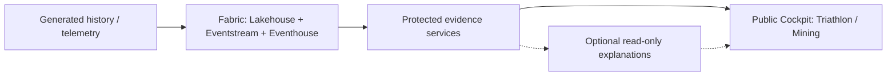

# Two twins. One Fabric lab.

Explore how **Microsoft Fabric turns generated events into operational evidence**:
a triathlon training/race twin and a mining plant twin, in one public Cockpit.
Learn the flow, inspect the source times, then deploy and adapt your own instance.
This is a demonstration, not medical advice or an industrial control system.

**[Try Triathlon](https://ontologydemo.liberatetheinnerchild.net/)**
· **[Try Mining](https://ontologydemo.liberatetheinnerchild.net/mining/)**
· [Demo walkthrough](docs/business-user.md)
· [Screenshot gallery](docs/screenshots.md)
· [AI querying options in Fabric](docs/fabric-ai-query-options.md)

| Scenario       | What you can do                                                                                                               | Fabric's role                                                                                                  |
| -------------- | ----------------------------------------------------------------------------------------------------------------------------- | -------------------------------------------------------------------------------------------------------------- |
| **Triathlon**  | Explore training history, start a session or race, follow telemetry, inspect alerts and available explanations                | OneLake/Lakehouse history, Eventstream ingestion, Eventhouse analytics; optional Power BI and Foundry          |
| **Mining D01** | Start a shared ten-minute simulation, explore equipment and trends, distinguish waiting from observed sample-to-receipt delay | Separate Eventstream/Eventhouse, validated telemetry/state, quality-aware KQL and completed-run reconciliation |



The public cloud demos use **synthetic data through real configured Fabric**.
Visitors do not need Fabric accounts; authorized operators do for native Fabric
views. Model/report/delegated features have separate configuration and access
requirements. Capacity suspension or an unavailable feed can interrupt the demo;
trust its quality/freshness indicators, not a page load.
Mining admits one shared writer, with a ten-minute start interval; join an
existing run instead of repeatedly selecting Start.

## Run locally without accounts

Install **Node.js 24+**, then:

```powershell
git clone https://github.com/ribumann/fabrictritwin.git
Set-Location fabrictritwin
node .\scripts\demo.mjs
```

Open **http://localhost:3300**. The launcher restores packages, builds and starts
the real Cockpit plus an in-memory synthetic backend. Ctrl+C stops both.
Initial package download needs internet; ports 3000/3300 must be free.
This account-free profile is **Triathlon-only**: it does not simulate Fabric,
Mining ingestion, Power BI or an LLM. State resets on restart.

## Deploy your own instance

Follow the [Developer deployment quickstart](docs/developer.md#deploy-your-own-fabric-connected-instance):
check identity/network/capacity, provision Azure/Fabric, add isolated Mining
items, release images, then run UAT. Bring your own subscription, capacity and
permissions. This is staged, not one-click, and can incur costs.

## Choose your path

| You are a...      | Start here                                                                                                                 |
| ----------------- | -------------------------------------------------------------------------------------------------------------------------- |
| **Business user** | [Guided demos](docs/business-user.md): what to click, what each signal means, what Fabric contributes                      |
| **Architect**     | [Architecture](docs/architect.md): L0-L2 views, trust boundaries, full data flow/model, decisions, limitations and debt    |
| **Developer**     | [Build and extend](docs/developer.md): deployment, UAT, L1-L4 views, contracts, implementation patterns and technical debt |

[Known limits](docs/architect.md#architecture-debt-and-limits) include native
Operations Agent automation and live ontology binding, neither accepted/enabled.

## Use it, adapt it, collaborate

Fork the lab, try a small scenario change and contribute a focused PR with
tests, diagrams and sanitized evidence. See [CONTRIBUTING](CONTRIBUTING.md),
[security reporting](SECURITY.md), the [MIT license](LICENSE) and
[third-party notices](THIRD_PARTY_NOTICES.md).
