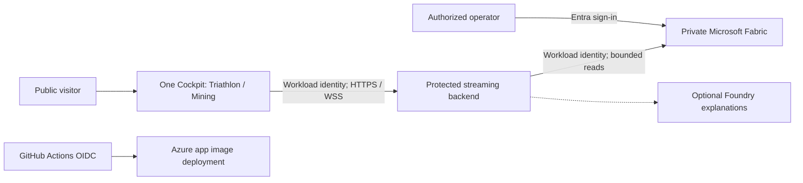
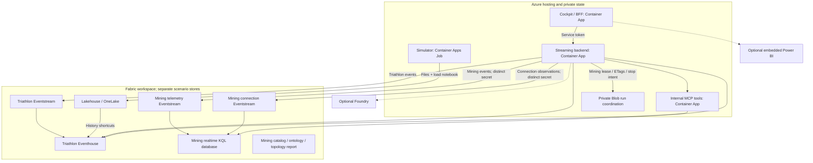
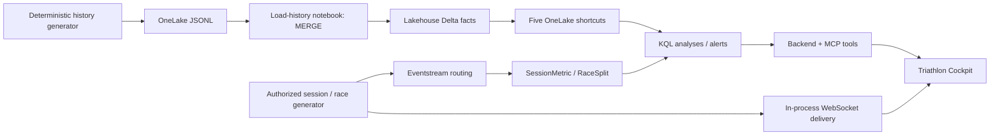
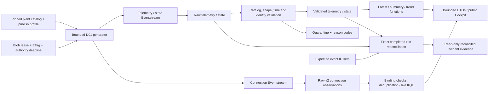
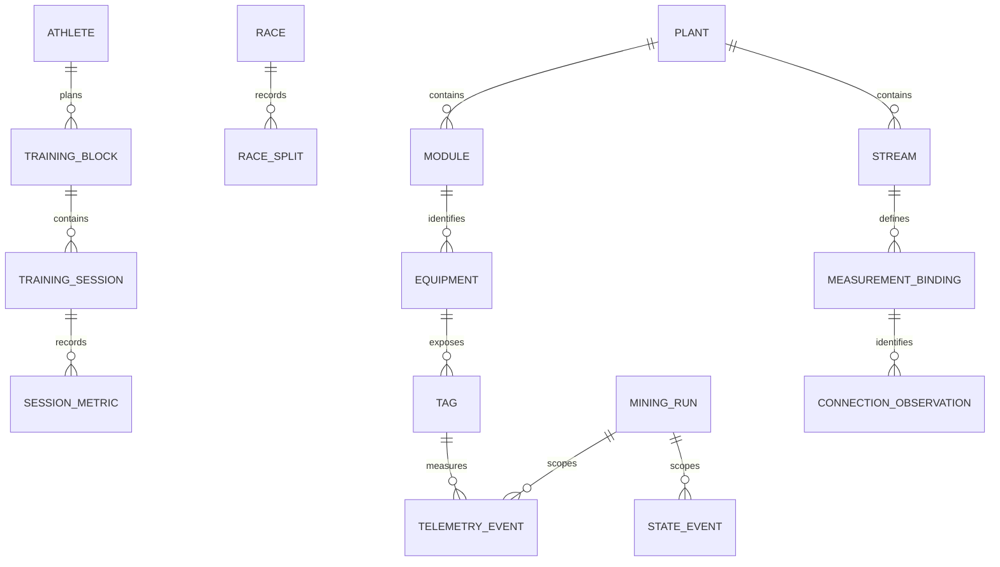
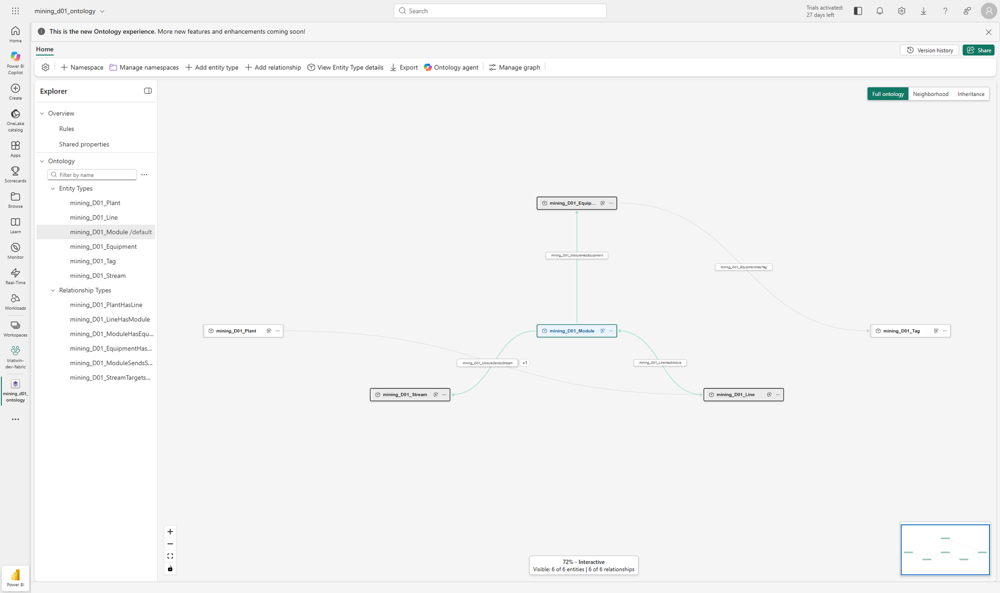

# Architect: boundaries, data and decisions

[Lab](../README.md) | [Business walkthrough](business-user.md) | [Developer](developer.md)

This is a **learning lab**, not a production reference certification. Both
scenarios use generated data. The diagrams describe checked-in paths; a
deployment must separately prove its identities, routing, bindings and freshness.
Solid arrows are data/request paths; dotted arrows are optional integrations.
**View key:** L0 = system context and trust; L1 = containers/services;
L2 = scenario components and data flows. These are this lab's documentation levels.

## L0: system context and trust

**Public web access is not public Fabric access.** Cockpit constructs service
authentication, rather than forwarding visitor credentials. The backend checks
the caller, allowed athlete/plant/run and query bounds. Native Fabric views and
delegated tools require their own permissions and, where applicable, consent.

## L1: containers and integration

The Eventstream backing endpoint is Fabric-managed. Do not model it as another
Azure Event Hubs service provisioned by this repository. Mining shares hosting
and potentially capacity/workspace, **not** the Triathlon stream/database.

## L2: Triathlon data and experience

Event time can be accelerated relative to wall time. Compare source timestamps,
receipt timestamps and scenario time deliberately. The live browser stream is
not an ingestion acknowledgement. Current live-run admission and stream state
are process-local, unlike Mining's durable coordination. The hosted lab therefore
uses one live backend replica: horizontal scaling can separate HTTP admission,
WebSocket delivery and in-memory race reads. This trades high availability for
consistent demo behavior until those responsibilities are externalized.

## L2: Mining data quality and run ownership

A lease enforces one admitted writer; it does not create exactly-once transport.
The hosted run-independent connection path does not use a Fabric run pin or
per-run connection reconciliation; its live reads deduplicate by tag and
sample time. Expected IDs, distinct/copy counts and conflict checks establish
bounded ingestion evidence for the run-scoped legacy and pinned-v1 paths.
Continuous operation remains supported as an explicit
operator-managed alternative; it must not be relabeled as a completed finite run.

## Full data architecture

| Layer                | Triathlon                                                                           | Mining                                                                                |
| -------------------- | ----------------------------------------------------------------------------------- | ------------------------------------------------------------------------------------- |
| Domain source        | Athlete, training block/phase/session, race, recovery, sleep, nutrition, equipment  | Plant D01, 24 modules, equipment, 56 tags, streams, pinned publish profile            |
| History / catalog    | Generated JSONL -> notebook MERGE -> Lakehouse Delta                                | Versioned JSON catalog; separate static Lakehouse/ontology/topology projections       |
| Transport            | `entityType`-routed session and race envelopes                                      | Separate telemetry/state and connection Eventstreams                                  |
| Raw/event facts      | `SessionMetric`, `RaceSplit`                                                        | `mining_TelemetryRaw`, `mining_PlantStateEvents`, `mining_ConnectionMeasurementRaw`   |
| Validated / rejected | Typed telemetry mappings and query logic                                            | Legacy validated/quarantine tables; v1 connection validated/quarantine tables         |
| Serving              | KQL functions/materialized views, history shortcuts; optional semantic model/report | Run-scoped telemetry reads; run-free v2 latest/trend reads from raw connection events |
| Operations           | Process-local stream/run state                                                      | Private Blob admission, plant lease, immutable generation holds and incident journals |
| Retention            | Inspect deployed table/Delta policies; no blanket lifecycle guarantee               | Schema declares 7-day raw/validated/quarantine and 30-day alert/incident retention    |

The ER diagram is conceptual, not a claim that Kusto enforces relational foreign
keys. V2 connection observations are not scoped by a run ID on the wire.
Canonical field definitions and compatibility rules are linked in the
[Developer contract map](developer.md#contracts-and-models).

The [capture gallery](screenshots.md) separates public operational views from
private Fabric operator views and their sign-in requirements.

## Key decisions and trade-offs

| Decision                                    | Why                                                            | Cost / limitation                                                         |
| ------------------------------------------- | -------------------------------------------------------------- | ------------------------------------------------------------------------- |
| One public Cockpit, two domain entries      | Reuse hosting/authentication without mixing domain permissions | Shared release and hosting blast radius                                   |
| Eventhouse serving over bounded KQL         | Near-real-time evidence and explicit query limits              | Capacity, ingestion lag, query throttling and update-policy correctness   |
| Lakehouse history plus Eventhouse shortcuts | Avoid another copied historical serving store                  | Shortcut/schema/freshness dependency                                      |
| Static ontology separate from telemetry     | Useful topology without claiming unsupported binding           | No accepted native full-property/time-series ontology binding             |
| Mining Blob lease and immutable holds       | Cross-replica single-writer authority and durable stop intent  | Coordination complexity; ambiguous operations require reconciliation      |
| Workload identities / OIDC                  | Avoid browser secrets and cloud passwords in CI                | Tenant configuration, exact audiences and permissions must be established |
| Account-free local profile                  | Reproducible Triathlon onboarding                              | In-memory, single-process; not Fabric or Mining evidence                  |
| Bounded Foundry evidence                    | Explain approved results, not arbitrary public KQL             | Optional model cost, availability and generated-answer risk               |

## Architecture debt and limits

| Debt                                                    | Consequence                                                           | Sensible next acceptance gate                                           |
| ------------------------------------------------------- | --------------------------------------------------------------------- | ----------------------------------------------------------------------- |
| Triathlon process-local admission/stream state          | Replicas or restarts can split observations; no environment-wide lock | Shared admission and durable run/result protocol                        |
| Capacity-cycle Eventstream recovery is manual           | A source may run while derived routes remain paused                   | Scoped topology probe, approved repair, fresh exact-run receipts        |
| Native Operations Agent remains unconfigured            | No accepted autonomous native rule/actions path                       | Read back correct generated rules and prove a dry-run action            |
| Static ontology, no live telemetry binding              | Topology exploration is not live ontology processing                  | Supported binding plus timestamped end-to-end proof                     |
| Optional report/delegated features are tenant-sensitive | Item creation is not interactive/authentication acceptance            | Browser UAT with intended user/account and least privilege              |
| No production SLA, failover or no-loss guarantee        | Demo can become unavailable or stale                                  | Capacity/cost policy, SLOs, load/failure testing and recovery ownership |

Older milestone diagrams and dated evidence are retained in
[release architecture](release-architecture.md) and the [operations runbook](live-runtime-operations.md).
They are diagnostic references, not the current onboarding path.
