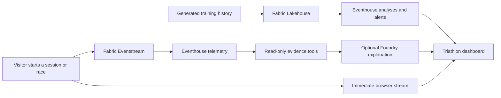
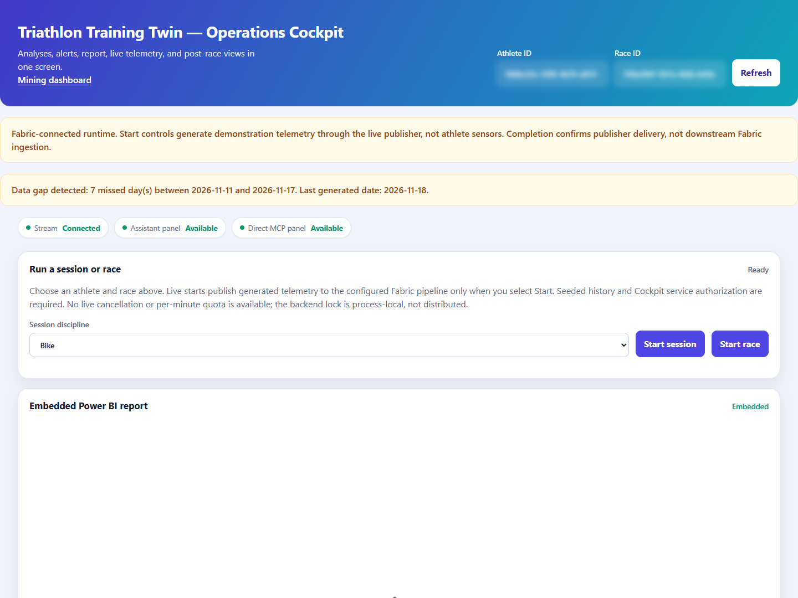
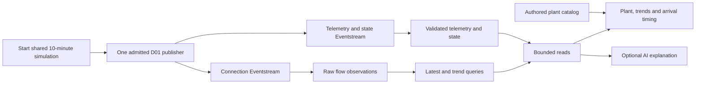
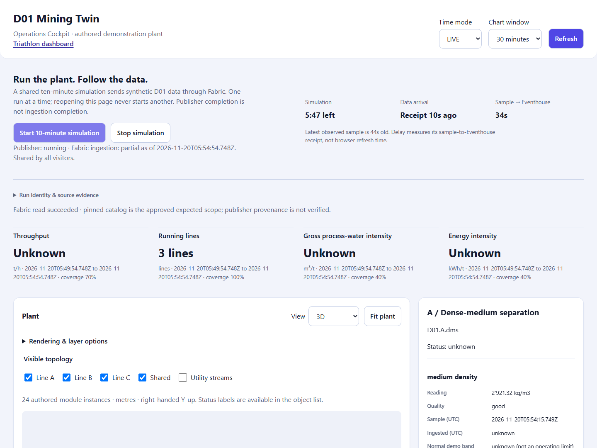

# Business user: explore two twins

[Back to the lab](../README.md) | [Architect](architect.md) | [Developer](developer.md)

**You need only a browser for the public demos.** The measurements are generated,
not personal health data or real mine telemetry. Opening either dashboard does
not start a simulation. The header links switch between the two scenarios.

## 1. Triathlon: from training history to a live race

[Open the Triathlon dashboard](https://ontologydemo.liberatetheinnerchild.net/)

**Question:** how can an operator combine training history, live performance and
an explanation in one place?

The immediate browser stream is a separate path. Seeing a heart-rate value move
does **not** by itself prove that Fabric received it.

| Do this                                                      | Look for                                                 | What it demonstrates                                             |
| ------------------------------------------------------------ | -------------------------------------------------------- | ---------------------------------------------------------------- |
| Open the dashboard and apply the seeded athlete/race context | Training history, source dates, analyses                 | OneLake history made queryable alongside telemetry               |
| Select **Start session**                                     | Stream status, changing measurements, completion summary | Generated session delivery; about 70 seconds of wall time        |
| After completion, select **Start race**                      | Swim/bike/run splits and finish summary                  | A compressed race scenario; about 47 seconds                     |
| Expand **Active alerts**                                     | Actual returned alert count and evidence                 | Query-derived observations, not medical advice                   |
| Inspect the assistant/report panels                          | Availability and source-specific output                  | Optional integrations fail visibly rather than inventing answers |

Try a question such as:

> Summarize the available training evidence and identify which source dates I
> should check before using the recommendation.

The cloud demo needs pre-seeded history. A missing-history or authorization
message is a setup problem, not an instruction to create your own account.
The [local quickstart](../README.md#run-locally-without-accounts) supplies a
credential-free Triathlon alternative.

## 2. Mining: start a plant, follow a measurement

[Open the Mining dashboard](https://ontologydemo.liberatetheinnerchild.net/mining/)

**Question:** can an operator distinguish plant activity, sensor evidence and
data-pipeline delay?

1. Select **Start 10-minute simulation**. The run is shared: another visitor
   sees the same run and cannot start a second writer. Starts are at least ten
   minutes apart; a busy/cooldown message means join the existing run or wait.
2. Read **Simulation** for time remaining. **Data arrival** counts waiting time
   until this browser observes receipts. Publishing and ingestion are separate.
3. When receipts arrive, compare **Sample -> Eventhouse** with sample age.
   The former uses the observed Eventhouse receipt timestamp, not independent
   raw-ingestion proof; the latter shows how old the measurement is now.
   Browser polling adds visibility delay. Unknown raw-ingestion time stays unknown.
4. Drag to orbit, scroll to zoom, or select **Fit plant**. Choose an equipment
   module to inspect tags, units, sample/ingestion times and topology.
   **Top view** and the keyboard-accessible equipment list are alternatives.
5. Compare A/B/C feed and the selected diagnostic. Missing, stale, bad-quality
   or insufficiently covered data remains unknown/unavailable, not healthy zero.
6. Let the run finish. The live connection stream does not provide per-run
   reconciliation; readings can still arrive afterward. **Stop simulation**
   requests a shared stop; it does not prove that the last batch has drained.

Suggested evidence question:

> Compare the available A/B/C feed evidence. State the time window, coverage
> and any missing evidence before explaining differences.

The embedded read-only explanation uses Foundry and server-selected evidence.
It cannot operate equipment. The separate native Data Agent covers static
topology; the public live-data assistant does not invoke it. Native Operations
Agent automation is not accepted or enabled.

See the [screenshot walkthrough](screenshots.md#mining-plant-and-evidence) for
desktop, mobile, equipment, trend and timing examples.

## Understand the boundaries

| Signal                        | Means                                    | Does not mean                          |
| ----------------------------- | ---------------------------------------- | -------------------------------------- |
| Publisher running / countdown | A run was admitted and is executing      | Every event has arrived                |
| Fresh sample and receipt      | That measurement was observed            | Every sensor or window is complete     |
| Sensor-evidence status        | Freshness/quality of associated readings | Physical equipment health              |
| Publisher complete            | Sending ended                            | Exact ingestion reconciliation passed  |
| Fabric item exists            | An artifact was created                  | Its rules, binding or data are working |

Fabric workspace views require an authorized organizational account. The public
dashboard uses a protected backend; it does not publish Fabric credentials or
grant visitors workspace access. This lab is not a safety, control or medical system.

## If a demo looks quiet

Check whether a run is active, then inspect source times and the displayed
error. After a run ends, readings naturally age. Refreshing does not create data.
Capacity suspension, paused Eventstream routes, throttling or missing configuration
can make the hosted demo unavailable; there is no 24/7 service-level guarantee.
Use [Developer UAT and recovery](developer.md#uat-the-actual-environment), not
repeated Start clicks, to diagnose a broken path.
