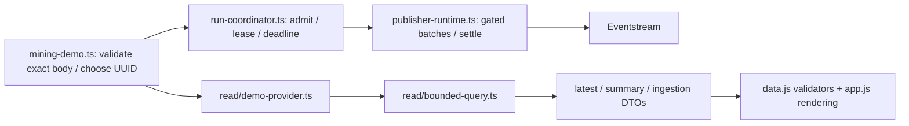
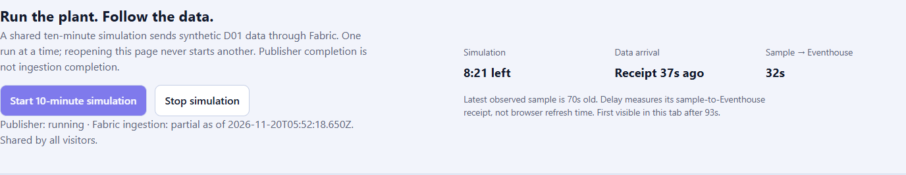

# Developer: run, deploy, verify, extend

[Lab](../README.md) | [Business walkthrough](business-user.md) | [Architect](architect.md)

**View key:** L1 = containers/services; L2 = components; L3 = runtime interactions;
L4 = code/module implementation. The Architect guide adds L0 system context.

## Local quickstart

Node.js 24+ and npm are sufficient for the account-free **Triathlon** demo:

```powershell
git clone https://github.com/ribumann/fabrictritwin.git
Set-Location fabrictritwin
node .\scripts\demo.mjs
```

Open `http://localhost:3300`; Ctrl+C stops both services. The launcher restores
locked dependencies, builds and checks ports 3000/3300. It needs internet for
initial packages, not Azure credentials. State resets on restart. The explanation
is deterministic, not an LLM; Power BI and live MCP are not simulated.
Mining geometry can be explored separately, but local synthetic mode does not
manufacture Mining/Fabric telemetry.

```powershell
npm ci
npm run build
npm test
npm run lint
npm run format
pwsh -File .\tests\pester\Run-Tests.ps1
```

PowerShell tests require PowerShell 7 and Pester 5.6.1. Infrastructure compilation
also needs Azure CLI/Bicep; image checks need Docker. Default Pester runs exclude
live integration tests. See [container checks](../tests/containers/README.md).

## Deploy your own Fabric-connected instance

**This is a staged deployment, not a one-click install.** Do not reuse the public
demo's IDs, secrets, workspace or domain. Budget for Azure/Fabric/optional model
costs. The main provisioning command does not enable every Mining gate.

### 1. Frontload identity, network and capacity

| Verify before provisioning                                                                 | Why                                                             |
| ------------------------------------------------------------------------------------------ | --------------------------------------------------------------- |
| Explicit tenant/subscription and permitted Entra application/role operations               | A successful Azure login is not Graph/Fabric authorization      |
| Fabric capacity, workspace access, service-principal tenant settings and supported regions | Capacity/model/preview availability differs                     |
| Access to ARM, Graph, Fabric API, OneLake, Kusto and Eventstream endpoints                 | Management-plane success is not data-plane connectivity         |
| Working cloud runner/dev machine, npm restore, Docker build and credential-free tests      | Separate environment failures from app defects                  |
| Separate workload identities and least-privilege storage/query/publish access              | Public visitors must never obtain backend or Fabric credentials |

Use the [complete configuration and identity inventory](dependencies-and-configuration.md)
as the authoritative checklist. Secret **names** are documented there; supply
values privately through the supported runtime secret boundaries.

### 2. Provision the shared Azure / Triathlon foundation

From the repository root in PowerShell 7, replace the example values:

```powershell
az login --tenant '<tenant-guid>'
$subscription = '<subscription-guid>'
$tenant = '<tenant-guid>'
$rg = 'rg-my-twin-lab'
$prefix = 'mytwin-dev'

Get-Help .\scripts\provision\provision-all.ps1 -Detailed
.\scripts\provision\provision-all.ps1 `
  -SubscriptionId $subscription -TenantId $tenant `
  -ResourceGroupName $rg -NamePrefix $prefix `
  -FabricCapacityAdminUpn '<your-fabric-admin-upn>' `
  -Location '<azure-region>' -FabricLocation '<fabric-region>' `
  -FoundryLocation '<foundry-region>' -WhatIf
```

`-WhatIf` is a planning aid, not a permission or consent test. The Azure bootstrap
skips Entra application creation in this mode; review application registration,
Graph permissions and tenant consent separately.

For example, the scripts default Foundry to `swedencentral`; validate capacity
and model availability in your subscription before choosing any region.
Review the scripts, proposed scope, tenant consent and costs before a real
invocation without `-WhatIf`. Bootstrap/placeholder images are **not working
apps**. Record outputs privately, then configure actual images, Eventstream,
OneLake/history loading, KQL and service authentication. Runtime configuration,
assistant consent and Power BI embedding have separate scripts under
[`scripts/provision`](../scripts/provision); inspect their exact help/parameters.
Do not pass secret values in shell history or publish provisioning output.

### 3. Add isolated Mining items and private state

Use your explicitly selected existing workspace/capacity and a fresh private
receipt path:

```powershell
.\scripts\provision\provision-fabric-items.ps1 `
  -Profile MiningStreaming -SubscriptionId $subscription -TenantId $tenant `
  -ResourceGroupName $rg -FabricCapacityName '<your-capacity-name>' `
  -ExistingWorkspaceId '<workspace-guid>' -NamePrefix 'mining-d01' `
  -ReceiptPath '<absolute-private-directory>\mining-create.jsonl' -WhatIf
```

The profile refuses to adopt same-named existing items. Review and apply the
definitions with [`apply-mining-definitions.ps1`](../scripts/fabric/apply-mining-definitions.ps1),
including source contracts, query functions and ingestion reconciliation.
The [Mining run contract](mining-run-coordination.md) and
[publisher runtime](mining-publisher-runtime.md) specify dedicated Blob state,
container-scoped access, Eventstream SAS, query identity, caller allow-lists and
feature gates. These are required configuration steps, not implicit grants.

For visitor-triggered runs, both backend continuous flags must be false:

```text
MINING_CONTINUOUS_ENABLED=false
MINING_CONTINUOUS_READ_ENABLED=false
```

Also configure the independently default-off publisher, coordination, public
demo/read and reconciliation gates described in the run contract. Never enable
a competing finite publisher beside a continuous owner: persist its generation
hold, verify terminal state and released lease first. Retain the hold.

### 4. Publish and deploy real app images

Configure **your fork's** `azure-build` and `azure-deploy` environment variables,
exact OIDC subjects and scoped identities using the
[image-release guide](../scripts/deploy/README.md). Workflows intentionally guard
the upstream repository identity: review/adapt that guard and the immutable-ID
OIDC subject for your fork before enabling them.

```powershell
$repo = '<your-github-account>/<your-fork>'
gh workflow run publish-app-image.yml --repo $repo --ref main `
  -f app=cockpit -f publish=false
# After approved preflight, use publish=true and read the confirmed manifest digest.
gh workflow run deploy-app-image.yml --repo $repo --ref main `
  -f app=cockpit -f image_digest='sha256:<reviewed-manifest-digest>' -f deploy=false
# After approved preflight, use deploy=true.
```

Valid `app` values are `cockpit`, `streaming-backend`, `mcp-tools` and `simulator`.
Deploy `cockpit`, `streaming-backend` and `mcp-tools` for the full lab.
Publish/deploy `simulator` when loading Triathlon history through its Container
Apps Job; image deployment does not execute that job.
Image-only deployment preserves runtime overlays; it does not bootstrap Fabric,
grant permissions or start jobs. Configure your own HTTPS/public domain and test
same-origin actions, protected backend ingress and WebSocket routing.
Keep schedules opt-in. Do not disable auth or TLS to fix connectivity.

**Keep the shared live backend at one replica while Triathlon state is
process-local.** Otherwise the start request, WebSocket and race reads can reach
different processes. Configure this before starting runs, never during an active
Mining publisher:

```powershell
az containerapp update --subscription $subscription --resource-group $rg `
  --name '<your-streaming-backend-app>' --min-replicas 1 --max-replicas 1
```

This is a demo availability trade-off, not distributed coordination. Externalize
Triathlon ownership/results and stream delivery before enabling horizontal scale.

## L1-L4 implementation views

L1 container boundaries are in the [Architect guide](architect.md#l1-containers-and-integration).
The following views drill down without duplicating that system picture.

### L2: source map

| Component           | Source                                                             | Responsibility                                                                   |
| ------------------- | ------------------------------------------------------------------ | -------------------------------------------------------------------------------- |
| Browser + BFF       | [`apps/cockpit/src`](../apps/cockpit/src)                          | Two page entries, same-origin API relay, service auth, optional report embedding |
| Application backend | [`apps/streaming-backend/src`](../apps/streaming-backend/src)      | Admission, live streams, bounded reads, optional explanations                    |
| Simulator/domain    | [`apps/simulator/src`](../apps/simulator/src)                      | Deterministic generated history/telemetry and Mining contracts                   |
| MCP adapter         | [`apps/mcp-tools/src`](../apps/mcp-tools/src)                      | Internal read-oriented evidence tools                                            |
| Infrastructure      | [`infra/bicep`](../infra/bicep), [`infra/fabric`](../infra/fabric) | Azure resources and Fabric item/schema definitions                               |

### L3: public Mining start to read

```mermaid
sequenceDiagram
  actor Visitor
  participant Browser
  participant BFF as Cockpit BFF
  participant API as Backend demo router
  participant Store as Blob coordinator
  participant Fabric
  Visitor->>Browser: Start 10-minute simulation
  Browser->>BFF: POST {plantId: D01}
  BFF->>API: Service-authenticated request
  API->>Store: Admit UUID; lease + ETag + cooldown
  Store-->>API: Durable admission
  API-->>Browser: 202 (not ingestion success)
  loop Authorized batches
    API->>Store: Check authority / stop intent
    API->>Fabric: Publish telemetry / state
  end
  Browser->>API: Same-origin bounded overview via BFF
  API->>Fabric: Fixed query template + validated parameters
  Fabric-->>Browser: Scoped DTO via API/BFF
  Note over Browser,Fabric: Display actual sample/receipt times; never infer arrival from sending
```

### L4: ownership and evidence implementation



| Pattern                        | Implementation / challenge                               | Solution and limit                                                                 |
| ------------------------------ | -------------------------------------------------------- | ---------------------------------------------------------------------------------- |
| BFF / anti-corruption boundary | Browser cannot select cloud credentials or arbitrary KQL | Service identity, scoped requests, validated DTOs                                  |
| Deterministic domain generator | Reproducible learning and expected event sets            | Pinned catalog/profile and stable event identities; not real equipment             |
| Lease + optimistic concurrency | Multiple Mining replicas / ambiguous writes              | Blob lease, ETags, authority deadlines and durable receipts; reconcile uncertainty |
| Explicit state machines        | Admission, stop and ingestion are different facts        | Preserve pending/unknown/interrupted; never translate 202 into completion          |
| Quality-aware projections      | Missing or uncertain readings can mislead                | Catalog joins, quarantine, coverage thresholds and null/unavailable values         |
| Stale-response protection      | Run/view changes race network responses                  | Abort, epoch/scope validation, bounded cache and hidden-tab polling pause          |

## Contracts and models

| Contract                    | Canonical source / key fields                                                                                                                                                   |
| --------------------------- | ------------------------------------------------------------------------------------------------------------------------------------------------------------------------------- |
| Triathlon domain            | [`models`](../apps/simulator/src/models): athlete, block/phase/session, race, health, equipment                                                                                 |
| Session telemetry           | [`telemetry.ts`](../apps/simulator/src/models/telemetry.ts): `sessionId`, UTC `timestamp`, heart rate, nullable power, pace/cadence, position                                   |
| Race telemetry              | Same file: `raceId`, `timestamp`, distance, current/planned pace, heart rate, leg, finish flag                                                                                  |
| Triathlon KQL               | [`DatabaseSchema.kql`](../infra/fabric/eventhouse/DatabaseSchema.kql): telemetry mappings, views, history functions                                                             |
| Mining domain               | [`plant-catalog.json`](../apps/simulator/src/mining/plant-catalog.json): module/equipment/tag/stream IDs and units                                                              |
| Mining numeric v2           | [`numeric-event-v2.schema.json`](../apps/simulator/src/mining/numeric-event-v2.schema.json): run/event IDs, sequence, cadence, exact UTC timestamp, D01 IDs, value/unit/quality |
| Mining state v2             | [`state-event-v2.schema.json`](../apps/simulator/src/mining/state-event-v2.schema.json): run/event identity and scoped reported state                                           |
| Mining storage / validation | [`MiningSchema.kql`](../infra/fabric/eventhouse/MiningSchema.kql), [`MiningValidation.kql`](../infra/fabric/eventhouse/MiningValidation.kql)                                    |
| Mining public reads         | [`contract.ts`](../apps/cockpit/src/mining/contract.ts): plant/run/catalog scope, bounded windows, quality and evidence                                                         |

Mining numeric payloads require schema 2, sequence >= 1, 30/60-second cadence,
64-lowercase-hex event IDs and millisecond UTC timestamps. The payload schema
excludes transport-only `entityType`; catalog joins additionally verify
equipment/module/tag, units and numeric envelopes. API DTOs use camelCase;
Mining source events use snake_case. Do not silently rename either boundary.
Wire schema acceptance alone is not source readiness.

## UAT the actual environment



The following are acceptance criteria for **your deployment**, not a blanket
claim that every optional feature has passed in the hosted lab.

| Check                    | Action                                                    | Pass evidence                                                                  |
| ------------------------ | --------------------------------------------------------- | ------------------------------------------------------------------------------ |
| Anonymous navigation     | Open `/`, follow Mining, follow Triathlon back            | Both real pages render; no visitor Fabric token required                       |
| Triathlon start/finish   | Run a session, then a race with seeded context            | Visible lifecycle and summary; separately check exact entity IDs in Eventhouse |
| Mining admission         | Start once; try from another visitor                      | Server duration 600 seconds; second start rejected with 409                    |
| Mining ingestion         | Wait for receipts and compare sample/receipt times        | Fresh exact-run validated rows, observed receipt lag; no fabricated zeros      |
| Mining completion        | Let ten minutes elapse and wait for ingestion             | `publisher_complete` plus exact expected-ID reconciliation, no conflicts       |
| Stop path (separate run) | Request Stop and observe settlement                       | Stop intent distinct from stopped; no claim of complete finite ingestion       |
| Stale/replay             | End a run, wait; inspect an allowed historical view       | Old samples age truthfully; replay is labeled historical                       |
| UI access                | Zoom, fit, select modules; keyboard list; narrow viewport | Selection details remain related; no horizontal overflow                       |
| Optional integrations    | Exercise intended model/report/delegated user path        | Actual rendered answer/report; explicit unavailable/consent errors retained    |
| Failure boundary         | With controlled scope, test unavailable source            | No healthy zero, anonymous backend fallback or arbitrary query escape          |

For Mining, inspect `mining_SourceReadiness()` and the exact-run validated
counts. For Triathlon, query `SessionMetric` by generated `sessionId` or
`RaceSplit` by `raceId`, including `ingestion_time()`. A browser stream,
successful deployment or HTTP 200 is not downstream acceptance.
The [operator runbook](live-runtime-operations.md) and
[Eventstream recovery guide](../scripts/fabric/README.md#recover-paused-eventstream-routing)
cover the existing guarded checks. Record revision, run/entity ID, source times,
expected/observed counts and uncertainty privately; share only sanitized evidence.
Mining recovery is currently pinned to the reviewed public-lab target. A new
deployment must review/adapt that exact-scope guard, not reuse its IDs or weaken
its topology checks. See [visual UAT examples](screenshots.md).

## Technical debt worth tackling

### Measure live latency

Use the browser probe once per scenario against an idle demo, then query the
exact run ID using a private Fabric identity. The browser probe needs
Playwright and Microsoft Edge, and starts a real shared run.

```powershell
node .\scripts\simulate\measure-twin-latency.mjs $origin mining
node .\scripts\simulate\measure-twin-latency.mjs $origin triathlon
.\scripts\simulate\measure-fabric-latency.ps1 -SubscriptionId $subscription `
  -KustoEndpoint $cluster -Database $database -Scenario mining -RunId $runId
```

In the backend console logs, filter `telemetry=twin-latency-v1` by `runId`.

The public Mining run flushes its initial plant-state events at the 5-second
tick. After the publisher send succeeds, Cockpit can show a separate modeled
hopper reading while waiting for Fabric. This preview isn't used for trends,
reconciliation, or the Fabric arrival timer. The telemetry sampling cadence
and event IDs are unchanged.

The two Mining raw input tables use a 10-second queued batching window;
catalog/profile joins still require queued ingestion. To roll back the
table overrides and restore database inheritance, run these against the
Mining Eventhouse database:

```kusto
.delete table mining_TelemetryRaw policy ingestionbatching
.delete table mining_PlantStateEvents policy ingestionbatching
```
`admission` measures the admitted backend handler; `send` records wall-clock
generation and SDK send boundaries plus monotonic send duration. Correlate
Triathlon session rows by run ID and sample time and Mining by event ID where
available, otherwise by batch sample time. Race publisher traces also carry
the race ID; the browser/query probe runs a Triathlon **session** by default.
Treat simulated sample timestamps as join keys, not as wall-clock emission.

The sender's acknowledgement is not an independent Event Hubs enqueue
timestamp. The exact-run probe reads enqueue and processing timestamps when
the Eventstream envelope preserves them, and separately reads Eventhouse raw
and Mining validated receipts. `processedAt` is the timestamp supplied by the
route, not a separate timestamp per operator. Null means the stage was not
observed. Triathlon renders from WebSocket after successful send, without
waiting for Eventhouse, while Mining polls a Fabric-backed API.

Prioritize durable Triathlon admission/results, automated scoped route recovery,
repeatable new-tenant bootstrap, schema/diagram drift checks and systematic
failure/load tests. Native Mining Operations Agent rule acceptance and live
ontology binding remain separate platform work, not missing UI buttons.
Some alert queries approximate a consecutive-split condition with counts within
a leg; inspect `DatabaseSchema.kql` before using them beyond the scripted lab.
See the [architecture debt table](architect.md#architecture-debt-and-limits).

Contribute small PRs with a reproducible scenario, relevant focused tests,
updated contracts/diagrams and sanitized evidence. Start with
[CONTRIBUTING](../CONTRIBUTING.md); disclose security issues through
[SECURITY](../SECURITY.md), not public credentials or logs.
