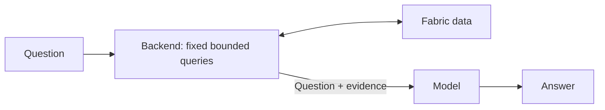
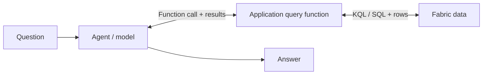
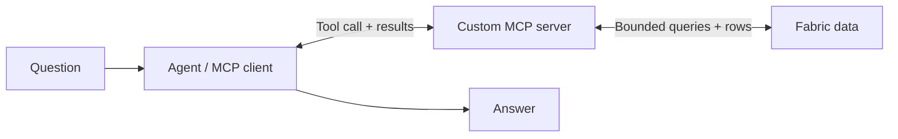
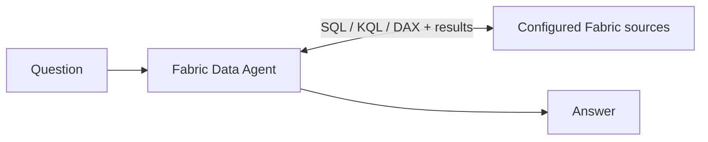
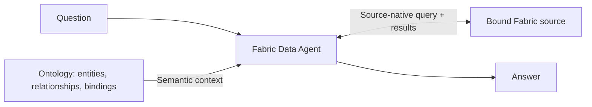
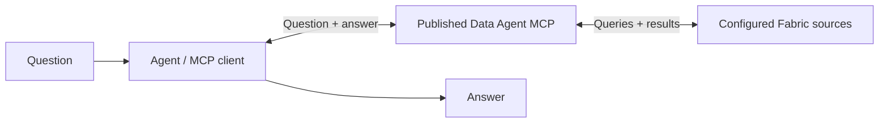
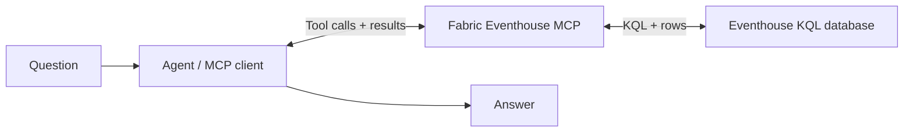
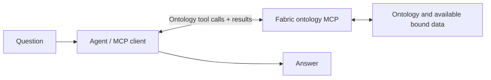

# AI querying options for Fabric

[Lab](../README.md) | [Architecture](architect.md) | [Mining flow and data models](mining-learning-guide.md)

An AI model does not see live Fabric data by itself. An application, tool, or
Fabric data agent must retrieve evidence and supply it to the model. MCP is a
protocol for exposing tools, not a database or a guarantee of correct answers.
These patterns can be combined; the diagrams show retrieval, not ingestion.

**Status checked:** 26 November 2026. Preview features, permissions, regions,
and APIs can change. Check the linked Microsoft documentation and your tenant
before choosing a production design.

## Compare the options

| Option | Benefits | Limitations and status |
| --- | --- | --- |
| [Pre-fetched evidence](#1-pre-fetched-evidence) | Simple, bounded, predictable data access. | Fixed evidence may not answer follow-up questions; the model cannot fetch more. |
| [Direct agent function](#2-direct-agent-function) | Agent selects a query when needed without an MCP server. | Application owns authorization, query safety, hosting and tool design. |
| [Custom MCP tools](#3-custom-mcp-tools) | Reusable, domain-specific tools with explicit contracts. | Extra service, identity boundary and network hop; MCP does not enforce safe queries by itself. |
| [Fabric Data Agent](#4-fabric-data-agent) | Fabric manages natural-language query generation across supported sources. | Requires source permissions and answer validation; the standard runtime is GA, while the preview runtime and some capabilities are preview. |
| [Data Agent with ontology](#5-data-agent-with-ontology-context) | Domain entities, relationships and bindings help interpret business questions. | **Preview** ontology context and binding; context and materialized graph freshness are separate from source-data freshness. |
| [Fabric Data Agent MCP](#6-published-data-agent-as-mcp) | Reuse a published Data Agent from an MCP client. | Requires publication, compatible MCP client and Fabric authentication; source-specific identity restrictions still apply. The linked current documentation does not label the MCP endpoint's release status. |
| [Remote Eventhouse MCP](#7-remote-eventhouse-mcp) | Managed MCP access to KQL discovery and queries, including current Eventhouse data. | **Preview**; requires permissions, manual setup and Copilot in Fabric for schema discovery. |
| [Ontology MCP](#8-ontology-mcp) | An agent can discover and query ontology context through MCP. | **Preview**; a documented issue currently prevents service-principal access. Ontology availability does not prove live telemetry binding. |

### 1. Pre-fetched evidence

Best when the product knows which evidence an answer needs. The public Mining
assistant follows this pattern: the backend reads Fabric evidence and the model
interprets it without tools. Its evidence is a snapshot, not unlimited access to
the database. See [Mining assistant](../apps/streaming-backend/src/mining/assistant.ts)
and [evidence route](../apps/streaming-backend/src/api/mining-demo.ts).

### 2. Direct agent function

The application exposes a function directly to the agent; the function calls
Fabric using an SDK or API. Prefer named, parameterized read-only operations
and bounded result sizes. If accepting generated queries, enforce an
independently validated read-only policy and limits rather than relying on
model instructions. This is a general pattern, not a claim that Mining
currently exposes agent functions.

### 3. Custom MCP tools

Use MCP when multiple clients should discover and reuse a controlled set of
domain tools. The public Triathlon assistant uses four athlete-scoped custom MCP
tools that query Eventhouse; the signed-in path can additionally offer the
Fabric Data Agent tool. The MCP server enforces its own authorization; it is
not automatically protected by the model's instructions. See the
[agent tool selection](../apps/streaming-backend/src/services/athlete-assistant-agent.ts)
and [MCP data service](../apps/mcp-tools/src/services/athlete-assistant-data.ts).

### 4. Fabric Data Agent

The Data Agent interprets a question and generates queries for configured
sources such as Lakehouse, Eventhouse and Power BI semantic models. The
[standard runtime is GA](https://learn.microsoft.com/en-us/fabric/data-science/data-agent-runtime);
the preview runtime and individual features can have different status. Supply
instructions and examples, inspect generated queries, and evaluate answers
against known results. See [Data Agent sources](https://learn.microsoft.com/en-us/fabric/data-science/data-agent-add-datasources).

### 5. Data Agent with ontology context

The **preview** ontology provides context; the underlying source executes the
query, not the ontology context itself. Context updates can take up to 10
minutes unless refreshed manually. That is not a telemetry latency guarantee:
source ingestion and query freshness are separate. A materialized ontology
graph has its own refresh and supported-source restrictions; it is not required
for this Data Agent path. See [ontology context](https://learn.microsoft.com/en-us/fabric/data-science/data-agent-ontology-sources),
[data binding](https://learn.microsoft.com/en-us/fabric/iq/ontology/how-to-bind-data)
and [graph materialization](https://learn.microsoft.com/en-us/fabric/iq/ontology/how-to-use-ontology-graph).

### 6. Published Data Agent as MCP

Publishing a Data Agent exposes one MCP tool representing the Data Agent.
The client needs streamable HTTP MCP support and its own Fabric bearer token;
dynamic client registration is not supported. The Data Agent still generates
and executes queries under the supported identity and source permissions.
Results sent to an external MCP client may leave Fabric's compliance boundary
or geographic region. See [Data Agent MCP](https://learn.microsoft.com/en-us/fabric/data-science/data-agent-mcp-server).

### 7. Remote Eventhouse MCP

This Fabric-hosted **preview** MCP server exposes schema discovery, query
generation and execution tools. The caller needs database read/query access;
schema discovery additionally requires Copilot in Fabric. Configuration is
currently manual. Use scope and query limits appropriate to the client and
review the generated queries. See [remote Eventhouse MCP](https://learn.microsoft.com/en-us/fabric/real-time-intelligence/mcp-remote-eventhouse).

### 8. Ontology MCP

This **preview** endpoint exposes ontology discovery and query capabilities.
Check actual tool support, identity, bindings and freshness for the selected
ontology; an ontology item alone does not establish a live telemetry path.
Microsoft documents a known issue preventing service principals from accessing
this endpoint. See [ontology MCP](https://learn.microsoft.com/en-us/fabric/iq/ontology/how-to-use-ontology-mcp-server).

## Identity, freshness and the two twins

- **Public app does not mean public Fabric.** A backend or tool may use a
  workload identity and must authorize and limit each request. A signed-in
  Data Agent caller needs access to its sources. Never pass a browser privileged
  Fabric credentials or rely on prompt instructions for authorization.
- **Data Agent identity differs from direct queries.** Microsoft documents
  service-principal authentication for published Data Agents as preview, but
  not for agents connected to KQL databases; managed identities are not
  supported for Data Agent authentication. These restrictions do not mean
  workload identities cannot query Eventhouse directly. See
  [Data Agent identity limitations](https://learn.microsoft.com/en-us/fabric/data-science/data-agent-service-principal).
- **Freshness is end-to-end.** Measure sample time, ingestion/receipt time,
  query time and any ontology or graph refresh separately. Report stale,
  missing and simulated values; a tool call or recent answer is not proof of
  fresh or complete data.
- **Lab status:** Mining uses pre-fetched evidence; Triathlon uses custom MCP
  and optionally a delegated Data Agent. The checked-in Triathlon Data Agent
  defines Lakehouse and Eventhouse sources, not an ontology source. The separate
  private Mining Data Agent covers static topology, not the public live
  assistant; see [Mining Data Agent](mining-data-agent.md). These are design and
  checked-in evidence, not a guarantee of current deployment health.

For a more flexible public Mining assistant, a practical next step is to expose
the existing bounded reads as a few plant-scoped, read-only tools for current
readings, trends and context. Add MCP if reuse across clients warrants it;
retain explicit quality, access, size and time limits. Treat an
ontology-grounded live Data Agent as a separate authenticated proof, not an
assumed replacement for the public path.
