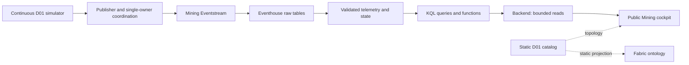

# Explore the D01 mining digital twin

The [public Mining cockpit](https://ontologydemo.liberatetheinnerchild.net/mining/)
shows a simulated plant connected to Microsoft Fabric. The measurements and line
states are generated, not readings from real equipment. Fabric itself requires
an authorized account; public visitors do not need one to view the cockpit.
The account-free local demo in the main README is currently triathlon-only.

## Follow a measurement



The Eventstream, Eventhouse, KQL database and tables are separate from the
triathlon stream. The catalog describes modules, equipment and tags; its
ontology is static and is not a native live time-series binding. Publisher
completion, query success, and downstream ingestion completeness are different
claims.

## In the cockpit

1. Open the public Mining view and inspect the source and owner status.
2. Read a KPI's timestamp, window, coverage and quality before interpreting its
   value. An unavailable value is not zero, and an older valid value is not
   necessarily live.
3. Select a module to inspect its individual tag measurements and their units.
   A simulator-reported line state and a sensor-derived status are not proof of
   physical equipment health.
4. Explore trends or advisory views when the cockpit marks them available.
   Run changes and missing samples are gaps, not continuous observations.

The simulator can restart with a new run ID and warm up again. A gap across
restart is real; do not join runs as though their time series were continuous.
Native Data Agent and Operations Agent experiments remain parked.

## In Fabric

With permission to the workspace, open the **mining-d01-eventstream** and follow
its Eventhouse destination to the configured Mining realtime KQL database. The
Eventhouse default database may be a different database: check the cockpit's
source display or your deployment configuration before querying.

In a KQL query set, start with readiness:

```kusto
mining_SourceReadiness()
```

Then inspect the latest validated measurements, including run and quality:

```kusto
mining_ValidatedTelemetry
| where plant_id == "D01" and timestamp > ago(30m)
| project timestamp, received_at, run_id, tag_id, value, unit, quality
| order by timestamp desc
| take 100
```

Compare run segments and event-time coverage for one tag:

```kusto
mining_ValidatedTelemetry
| where plant_id == "D01" and timestamp > ago(24h)
| where tag_id == "D01.A.crusher.ore_flow"
| summarize samples=count(), first_sample=min(timestamp), last_sample=max(timestamp)
    by run_id, bin(timestamp, 5m)
| order by timestamp asc
```

These are exploratory raw row counts, not deduplicated KPI calculations or
completeness checks. Look for absent bins, changing run IDs and delays between
`timestamp` and `received_at`. Use the source functions and the cockpit's
coverage/quality rules when interpreting a metric.

Line states are in `mining_ValidatedState`. A Fabric item or table existing
does not establish that it is populated, correctly bound, or complete. No
separate agent or incident ledger should be described as live merely because
its item exists.

## Run and modify the sample

See the main README for local setup, tests and the account-free triathlon demo.
For a Fabric-connected Mining deployment, start with the
[publisher runtime](mining-publisher-runtime.md),
[run coordination](mining-run-coordination.md) and
[configuration inventory](dependencies-and-configuration.md). Supply your own
resources, identities and secrets; never put credentials in the repository.
Production image publication and deployment are separate actions.
