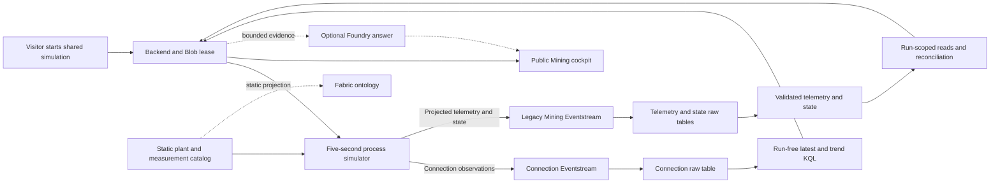
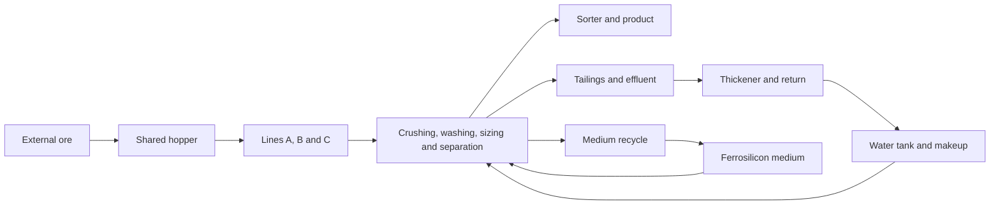

# Explore the D01 mining digital twin

The [public Mining cockpit](https://ontologydemo.liberatetheinnerchild.net/mining/)
shows a simulated plant connected to Microsoft Fabric. The measurements and line
states are generated, not readings from real equipment. Fabric itself requires
an authorized account; public visitors do not need one to view the cockpit.

See the [supervisor workflow and model limits](mining-supervisor.md) for the ore-flow board,
diagnostics, and the comparison with real processing plants.
Start with the [Business user walkthrough](business-user.md#2-mining-start-a-plant-follow-a-measurement)
for the current public, shared ten-minute simulation, plant interactions and
arrival-time indicators. The account-free local demo in the [main README](../README.md)
is Triathlon-only. This page retains the deeper measurement/query references.

## Follow a measurement



The Mining Eventstreams and database are separate from Triathlon. The catalog
describes the plant; its ontology is static, not a native live time-series
binding. Publisher completion, query success and ingestion completeness are
different claims.

## Simulation and data models

The public demo admits one shared ten-minute run. In the hosted run-independent
mode, it prepares both senders and starts without waiting for a Fabric
run-profile confirmation. The first simulated sample is five seconds after
start; Fabric ingestion and the browser display can take longer. The simulator
models ore, process water and ferrosilicon medium, including inventories,
transit, external inputs, outputs and drain-down. Its balance checks are model
checks, not proof about a physical plant.



This is a conceptual view of the modeled paths, not a piping or engineering
diagram. The static catalog and measurement bindings are the source of exact
stream endpoints and components.

| Model                       | Contents and cadence                                                                                                                                          | Identity and use                                                                                                                                |
| --------------------------- | ------------------------------------------------------------------------------------------------------------------------------------------------------------- | ----------------------------------------------------------------------------------------------------------------------------------------------- |
| Plant catalog               | D01 modules, equipment, ports, streams and telemetry tags                                                                                                     | Versioned static topology; module-port bindings do not invent equipment-owned ports.                                                            |
| Connection bindings         | 50 streams and 57 measurement bindings, including separate solids and water for mixed flows                                                                   | Each binding identifies a stream, source and target, quantity, unit and nominal visualization scale.                                            |
| Live connection observation | Five-second synthetic sample: `sample_time`, `measurement_tag_id`, `stream_id`, quantity, basis, value, unit, quality, endpoints and catalog/profile versions | Schema v2 omits `run_id`, `event_id` and `sequence` on the wire. The latest and trend APIs use plant scope, not a user-supplied run ID.         |
| Legacy telemetry and state  | Projected numeric tags at 30/60-second intervals and line/shared state events                                                                                 | Schema-v2 `PlantTelemetry` and `PlantStateEvent` retain internal run and event IDs; they are a distinct event family from connection schema v2. |
| Live read DTOs              | Latest readings carry sample and receipt times, value, unit, quality and status. Trends return 30/60-second windows, counts and coverage.                     | Missing remains null, real zero remains zero; bad, uncertain, stale and partial data are labeled.                                               |

Dry-solids flow is measured in `t/h`; water and medium volume flow are
measured in `m3/h` and remain separate quantities. The live query reads the
raw connection table, validates key binding fields, and selects the latest
receipt for duplicate tag/sample-time observations. Latest reads look back ten
minutes. Trend windows include late arrivals; six good samples are expected
per 30 seconds and twelve per minute. Incomplete windows remain partial.
The UI labels older usable readings delayed and, when a five-minute summary is
unavailable, shows the latest available feed sum with its line count.

For example, the connection publisher emits the following shape for a line-A
feed observation. The versions and timestamp shown are illustrative; source
and target equipment IDs are null because the catalog binds module ports:

```json
{
  "entityType": "ConnectionMeasurement",
  "schema_version": 2,
  "sample_time": "2026-01-01T12:00:05.000Z",
  "sample_interval_seconds": 5,
  "plant_id": "D01",
  "catalog_version": "sha256:0ba278e5e28b3466381534c5a920ce28b551cb3a7ddfc68cdf4371749f2c62ce",
  "measurement_catalog_version": "d01-connection-measurements-v1",
  "profile_version": "d01-shared-flow-v1",
  "stream_id": "process-A-feed",
  "measurement_tag_id": "D01.connection.process-A-feed.dry_solids_mass_flow",
  "source_module_id": "D01.shared.hopper",
  "source_port_id": "ore-out",
  "source_equipment_id": null,
  "source_equipment_port_id": null,
  "target_module_id": "D01.A.crusher",
  "target_port_id": "ore-in",
  "target_equipment_id": null,
  "target_equipment_port_id": null,
  "quantity": "dry_solids_mass_flow",
  "basis": "dry_solids",
  "value": 42,
  "unit": "t/h",
  "quality": "good",
  "origin": "synthetic_sensor_observation"
}
```

The backend adds the actual Fabric receipt time to the read response; it is
not a publisher-supplied event field. Latest responses cover the catalog's
bindings even when observations are missing. See
`apps/simulator/src/mining/connection-catalog.ts`,
`connection-publisher.ts` and `apps/streaming-backend/src/mining/read/connection-live-dto.ts`
for the authoritative contracts.

Simulation controls and legacy telemetry still use an internal run ID.
Run-specific **connection** reconciliation applies to the older pinned v1
path, not the current v2 live stream. Missing observations do not block reads;
the publisher can still stop on missed tick deadlines or transport failures.
See [publisher integration and rollback](mining-connection-publisher-integration.md)
and the [v1 Fabric contract](mining-connection-flow-fabric.md).

## In the cockpit

1. Open the public Mining view and inspect the source and owner status.
2. Read a KPI's timestamp, window, coverage and quality before interpreting its
   value. An unavailable value is not zero, and an older valid value is not
   necessarily live.
3. Select a module to inspect its individual tag measurements and their units.
   A simulator-reported line state and a sensor-derived status are not proof of
   physical equipment health.
4. Check the cockpit's availability indicators before exploring trends or other
   views. Completed-run incidents and explanations can remain unavailable until
   ingestion reconciliation completes. Do not treat historical evidence as proof
   that a capability is currently ready.

The simulation has an internal run ID, but the live connection stream is
plant-scoped. Gaps between runs are real. The separate private native Data
Agent covers static topology, not the public live-data assistant; see
[its documented limits](mining-data-agent.md). Native Operations Agent
automation remains unverified.

## In Fabric

With permission to the workspace, open the **mining-d01-eventstream** and follow
its Eventhouse destination to the configured Mining realtime KQL database. The
Eventhouse default database may be a different database: check the cockpit's
source display or your deployment configuration before querying.

In a KQL query set, inspect the run-free connection stream:

```kusto
MiningConnectionLiveLatestV2(now())
| project MeasurementTagId, SampleTime, ReceiptTime, Value, Quality
| take 100
```

For the separate legacy telemetry/state path, start with readiness:

```kusto
mining_SourceReadiness()
```

Then inspect the latest validated measurements, including run and quality:

```kusto
mining_ValidatedTelemetry
| where plant_id == "D01" and timestamp > ago(30m)
| project timestamp, received_at, run_id, tag_id, value, unit, quality
| order by timestamp desc
| take 100
```

Compare run segments and event-time coverage for one tag:

```kusto
mining_ValidatedTelemetry
| where plant_id == "D01" and timestamp > ago(24h)
| where tag_id == "D01.A.crusher.ore_flow"
| summarize samples=count(), first_sample=min(timestamp), last_sample=max(timestamp)
    by run_id, bin(timestamp, 5m)
| order by timestamp asc
```

These are exploratory legacy validated-table row counts, not deduplicated KPI
calculations or completeness checks. Look for absent bins, changing run IDs and
delays between `timestamp` and `received_at`. Use the source functions and the
cockpit's coverage/quality rules when interpreting a metric.

Line states are in `mining_ValidatedState`. A Fabric item or table existing
does not establish that it is populated, correctly bound, or complete. No
separate agent or incident ledger should be described as live merely because
its item exists.

## Run and modify the sample

See the main README for local setup, tests and the account-free triathlon demo.
For a Fabric-connected Mining deployment, start with the
[publisher runtime](mining-publisher-runtime.md),
[run coordination](mining-run-coordination.md) and
[configuration inventory](dependencies-and-configuration.md). Supply your own
resources, identities and secrets; never put credentials in the repository.
Production image publication and deployment are separate actions.
