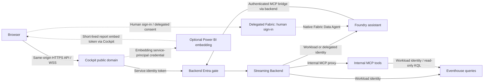
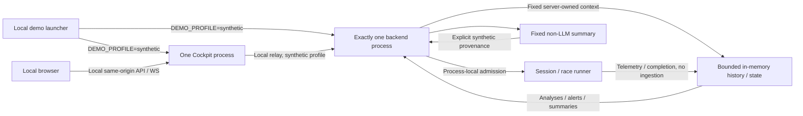

# Release architecture

These diagrams separate the **live Azure/Fabric topology**, the **account-free
synthetic target**, and the **protected image-release lane**. Arrows describe
data or request paths, not proof of availability. No operator-specific resource
names, identities, athlete identifiers, credentials, or raw measurements belong
here.

Source baseline: main at `33e726c` (including the MCP readable formatter and
Console source retirement). Status snapshot:
**8 November 2026**. These diagrams describe checked-in source, not proof of
the current resources or serving revision in any tenant.

## Live request and identity boundaries

Cockpit is the single intended operator UI and public custom-domain entry point.
Its anonymous surface does **not** make the backend anonymous: Cockpit authenticates
REST and WebSocket upstream calls using its workload identity, and backend
authorization maps the caller to an allowed athlete. Backend external ingress
remains authenticated; MCP ingress is internal-only, not a second public UI.
Legacy Console source, provisioning, and release targets are retired. A
previously deployed Console app or identity may still exist: incremental
provisioning does not delete it, and existing authorization/callback entries are
preserved. The deployed Console is intentionally left running; cloud cleanup is
not a release prerequisite.

Anonymous live assistant calls use Foundry with MCP tools; this remains a
cloud-backed assistant, not a credential-free one. Foundry calls the authenticated
backend MCP bridge, which forwards to the internal MCP server. Native Fabric
Data Agent access requires a signed-in human and delegated On-Behalf-Of flow.
Power BI embedding uses Cockpit's dedicated embedding service principal.
Current source deliberately allows a visitor with no identity headers to request
an embed configuration without sign-in; a visitor presenting identity signals
must pass authentication and the viewer allow-list. The existing public image's
anonymous embed-config path returned ready/token, not proof of interactive report
rendering. Do not describe anonymous reports as visitor-authenticated.
Verified custom TLS/callback configuration does not prove human sign-in or these
delegated consent paths. Workload credentials, Eventstream SAS and optional client
secrets stay in their cloud boundaries; only the short-lived report embed token
is intentionally delivered to the browser, not the embedding client secret.

Sources: [Cockpit entry point](../apps/cockpit/src/index.ts),
[service authentication](../apps/cockpit/src/api/service-auth.ts),
[stream relay](../apps/cockpit/src/api/stream-relay.ts),
[Power BI access behavior](../apps/cockpit/src/api/powerbi.ts),
[assistant bridge](../apps/streaming-backend/src/api/assistant.ts),
[Foundry tool selection](../apps/streaming-backend/src/services/athlete-assistant-agent.ts),
and [Container Apps modules](../infra/bicep/modules).

## Live history, schema and telemetry are distinct paths

```mermaid
flowchart LR
    Daily["Simulator daily job"]
    Files["OneLake history files"]
    Notebook["Load-history notebook"]
    Delta["Lakehouse Delta history"]
    Shortcuts["Five OneLake shortcuts"]
    KQL["Eventhouse KQL functions / views"]
    Backend["Backend queries / streams"]
    UI["Cockpit"]
    Generator["Session / race generator"]
    Source["Eventstream custom source"]
    Default["Default stream"]
    Derived["Derived entity filters"]
    Tables["SessionMetric / RaceSplit"]

    Daily -->|"Generate target UTC day"| Files
    Daily -->|"Invoke and await"| Notebook
    Files -->|"JSONL input"| Notebook
    Notebook -->|"MERGE"| Delta
    Delta -->|"History exposed, not telemetry copied"| Shortcuts
    Shortcuts -->|"external_table queries"| KQL
    KQL -->|"Query results"| Backend
    Backend -->|"Same-origin relay"| UI
    Backend -->|"Authorized trigger"| Generator
    Generator -->|"Eventstream SAS publish"| Source
    Source --> Default
    Default --> Derived
    Derived -->|"Direct ingestion / JSON mappings"| Tables
    Tables --> KQL
    Generator -->|"In-process telemetry / completion"| Backend
```

The notebook loads files into Delta; it does not generate a new day by itself.
History shortcuts expose `TrainingSession`, `NutritionLog`, `RecoveryMetrics`,
`SleepSession`, and `TrainingBlockPhase` to Eventhouse queries. KQL schema,
ingestion mappings, materialized views and functions are checked-in definitions,
not another runtime service or evidence that a particular tenant has applied them.

Real-time telemetry uses the Fabric-managed custom endpoint, its default stream,
entity-type filters/derived streams, and direct Eventhouse ingestion into
`SessionMetric` and `RaceSplit`. The backing Event Hubs endpoint is Fabric-managed;
the diagram does not invent a separately provisioned Azure Event Hubs service.
The simulator job and backend can publish using the configured Eventstream SAS.
In-process WebSocket frames and completion summaries are a separate delivery path:
they do not establish that the corresponding rows reached Eventhouse.

**Dated evidence, not a continuing health guarantee:** on 7 November 2026,
the daily job, its notebook and public analytics showed freshness in one
environment. Following a prior derived-stream failure and repair, an authorized
existing Console session trigger was accepted on 8 November at 16:41 UTC. The
same run's Eventstream-to-Eventhouse aggregate contained 36 `SessionMetric`
rows with 36 distinct simulated timestamps, from 16:41:02.737 to 17:33:02.737
UTC. The recorded ingestion time was 16:42:15.8930759 UTC; the later event
times represent accelerated simulation, not future ingestion. This includes the
final metric of that 52-simulated-minute run. A separate earlier race observation
included 85 fresh `RaceSplit` rows including the finish. On 8 November, source,
default and derived streams and destination were observed running, with capacity
active.

These are bounded observations, not proof of every session, current availability,
or the revision now serving traffic. A direct user WebSocket attempt returned 403;
there is no user WebSocket proof from that attempt. Anonymous MCP-grounded
assistant and historical race delivery observations do not prove delegated human
consent. Use the [live runbook](live-runtime-operations.md) for the actual
serving revision and source dates; neither HTTP 200 nor an aggregate `asOf`
establishes freshness of every component.

Sources: [daily generator](../apps/simulator/src/index.ts),
[history loading](../scripts/simulate/load-history-to-tables.ps1),
[Eventstream definition](../infra/fabric/eventstream/eventstream.custom-endpoint.json),
[KQL definitions](../infra/fabric/eventhouse/DatabaseSchema.kql),
and [live simulation](../apps/streaming-backend/src/api/simulate.ts).

## Account-free synthetic demo: isolated local processes

Exact `DEMO_PROFILE=synthetic` selects the local synthetic history/insights and
bounded session/race experience; unset means `live`, invalid profiles fail
explicitly, and live errors do not fall back to synthetic data. The account-free
launcher supervises one Cockpit and one backend, sets the profile on both, waits
for readiness and stops its companion on failure. Package restore/build needs
downloads; the synthetic application path needs no Azure/Fabric account,
credentials, cloud storage, MCP, Foundry, Power BI or cloud ingestion. This is
logical/process isolation, not an OS network sandbox.

The local Cockpit-to-backend HTTP loopback is the only service-auth bypass.
Hosted Cockpit-to-backend calls retain managed-identity authentication, and
hosted synthetic use requires exactly one backend instance because admission and
state are process-local. See the
[hosted runtime profile safeguards](hosted-runtime-profiles.md).

Admission is **one active run per backend process**, no queue, and at most two
starts per rolling minute per process, with explicit busy/rate feedback. State
is bounded in memory and resets on restart. The live backend template permits
up to **three replicas**; hosted synthetic use requires separately enforced
**exactly one backend instance**, including revision/traffic topology. There is
no distributed lock or environment-wide rate limit. The image-only updater
below preserves scale; it cannot establish this prerequisite.

Sources: [demo launcher](../scripts/demo.mjs),
[backend profile mounting](../apps/streaming-backend/src/index.ts),
and [bounded synthetic routes](../apps/streaming-backend/src/api/synthetic.ts).
Local CI and image validation establish source/build behavior only; neither
proves hosted deployment, live Fabric health, image publication, or cloud
Console cleanup.

## Release lane: validation is not publication or deployment

```mermaid
flowchart LR
    PR["Pull request"]
    CI["Credential-free CI / image tests"]
    Main["Reviewed protected main"]
    BuildGate["azure-build approval / enable gate"]
    Publish["Build / smoke-test / OIDC publish"]
    ACR["Existing ACR: immutable digest"]
    DeployGate["azure-deploy approval / enable gate"]
    Update["OIDC image-only updater"]
    Workload["One existing app or simulator job"]

    PR -->|"No Azure credentials or OIDC"| CI
    PR -->|"Independent review / required checks"| Main
    Main -->|"Manual dispatch: one app"| BuildGate
    BuildGate --> Publish
    Publish -->|"Push selected app; record source + digest"| ACR
    ACR -->|"Explicit reviewed sha256 digest"| DeployGate
    Main -->|"Separate manual dispatch: one app"| DeployGate
    DeployGate --> Update
    Update -->|"Preserve non-image configuration"| Workload
```

PR CI builds/tests without Azure login, registry push, deployment or provisioning;
its local image config ID is not a pushed manifest digest. Publication is trusted
main only, with a separate `azure-build` OIDC identity and protected environment.
`publish: false` performs identity/registry-metadata preflight only.
`publish: true` additionally needs exact `PUBLISH_ENABLED=true`, approval and
authorized registry write access. Publication rebuilds/tests the chosen app;
it does not promote the PR's local image or deploy it.

The separate main-only `azure-deploy` lane requires exact
`DEPLOYMENT_ENABLED=true`, environment approval, a reviewed existing digest and
`deploy: true` for a write. It updates one existing Cockpit, backend, MCP app or
simulator job per dispatch; the retired Console is absent from build,
publication, and deployment targets. There is no infrastructure
provisioning, secret/identity/scale/domain overlay change, capacity resume or job
start. Tags are not immutable; review app, source revision, publication run and
digest together. Environment names alone do not enforce protection.

Publication and deployment are separate actions. The MCP readable formatter and
Console retirement are present in the source baseline, but their presence here
does not establish which images have been published or which revisions are
serving. Confirm the selected app's actual source revision, pushed digest and
traffic-serving revision in the operator's release record. Read-only OIDC
success, CI success and historical runtime evidence cannot replace these facts.
Final acceptance belongs to the user rather than another automated QA cycle.

Sources: [CI](../.github/workflows/ci.yml),
[build-only image CI](../.github/workflows/container-images.yml),
[publication](../.github/workflows/publish-app-image.yml),
[deployment](../.github/workflows/deploy-app-image.yml),
and [release prerequisites and preservation contract](../scripts/deploy/README.md).
