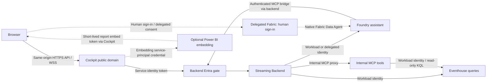
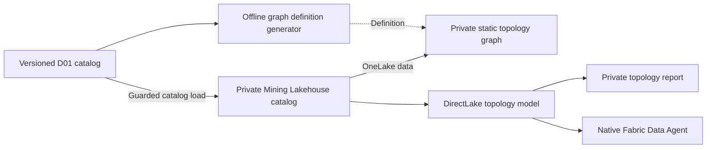
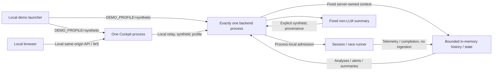

# Release architecture

These diagrams distinguish the **public D01 Mining demo** (generated synthetic
events sent to private Fabric), **private static Mining projections**, the
**account-free local synthetic target**, and the **protected image-release
lane**. Arrows describe data or request paths, not proof of availability. No
operator-specific identities, credentials, athlete identifiers, or raw
measurements belong here.

Source baseline: main through merged PR #87. Status snapshot: **15 November
2026**. These diagrams describe checked-in source and dated observations, not a
guarantee about current resources or the serving revision in any tenant.

## Live request and identity boundaries

Cockpit is the single intended operator UI and public custom-domain entry point.
Its anonymous surface does **not** make the backend anonymous: Cockpit authenticates
REST and WebSocket upstream calls using its workload identity, and backend
authorization maps the caller to an allowed athlete. Backend external ingress
remains authenticated; MCP ingress is internal-only, not a second public UI.
Legacy Console source, provisioning, and release targets are retired. A
previously deployed Console app or identity may still exist: incremental
provisioning does not delete it, and existing authorization/callback entries are
preserved. The deployed Console is intentionally left running; cloud cleanup is
not a release prerequisite.

Anonymous live assistant calls use Foundry with MCP tools; this remains a
cloud-backed assistant, not a credential-free one. Foundry calls the authenticated
backend MCP bridge, which forwards to the internal MCP server. Native Fabric
Data Agent access requires a signed-in human and delegated On-Behalf-Of flow.
Power BI embedding uses Cockpit's dedicated embedding service principal.
Current source deliberately allows a visitor with no identity headers to request
an embed configuration without sign-in; a visitor presenting identity signals
must pass authentication and the viewer allow-list. The existing public image's
anonymous embed-config path returned ready/token, not proof of interactive report
rendering. Do not describe anonymous reports as visitor-authenticated.
Verified custom TLS/callback configuration does not prove human sign-in or these
delegated consent paths. Workload credentials, Eventstream SAS and optional client
secrets stay in their cloud boundaries; only the short-lived report embed token
is intentionally delivered to the browser, not the embedding client secret.

Sources: [Cockpit entry point](../apps/cockpit/src/index.ts),
[service authentication](../apps/cockpit/src/api/service-auth.ts),
[stream relay](../apps/cockpit/src/api/stream-relay.ts),
[Power BI access behavior](../apps/cockpit/src/api/powerbi.ts),
[assistant bridge](../apps/streaming-backend/src/api/assistant.ts),
[Foundry tool selection](../apps/streaming-backend/src/services/athlete-assistant-agent.ts),
and [Container Apps modules](../infra/bicep/modules).

## Live history, schema and telemetry are distinct paths

```mermaid
flowchart LR
    Daily["Simulator daily job"]
    Files["OneLake history files"]
    Notebook["Load-history notebook"]
    Delta["Lakehouse Delta history"]
    Shortcuts["Five OneLake shortcuts"]
    KQL["Eventhouse KQL functions / views"]
    Backend["Backend queries / streams"]
    UI["Cockpit"]
    Generator["Session / race generator"]
    Source["Eventstream custom source"]
    Default["Default stream"]
    Derived["Derived entity filters"]
    Tables["SessionMetric / RaceSplit"]

    Daily -->|"Generate target UTC day"| Files
    Daily -->|"Invoke and await"| Notebook
    Files -->|"JSONL input"| Notebook
    Notebook -->|"MERGE"| Delta
    Delta -->|"History exposed, not telemetry copied"| Shortcuts
    Shortcuts -->|"external_table queries"| KQL
    KQL -->|"Query results"| Backend
    Backend -->|"Same-origin relay"| UI
    Backend -->|"Authorized trigger"| Generator
    Generator -->|"Eventstream SAS publish"| Source
    Source --> Default
    Default --> Derived
    Derived -->|"Direct ingestion / JSON mappings"| Tables
    Tables --> KQL
    Generator -->|"In-process telemetry / completion"| Backend
```

The notebook loads files into Delta; it does not generate a new day by itself.
History shortcuts expose `TrainingSession`, `NutritionLog`, `RecoveryMetrics`,
`SleepSession`, and `TrainingBlockPhase` to Eventhouse queries. KQL schema,
ingestion mappings, materialized views and functions are checked-in definitions,
not another runtime service or evidence that a particular tenant has applied them.

Real-time telemetry uses the Fabric-managed custom endpoint, its default stream,
entity-type filters/derived streams, and direct Eventhouse ingestion into
`SessionMetric` and `RaceSplit`. The backing Event Hubs endpoint is Fabric-managed;
the diagram does not invent a separately provisioned Azure Event Hubs service.
The simulator job and backend can publish using the configured Eventstream SAS.
In-process WebSocket frames and completion summaries are a separate delivery path:
they do not establish that the corresponding rows reached Eventhouse.

**Dated evidence, not a continuing health guarantee:** on 7 November 2026,
the daily job, its notebook and public analytics showed freshness in one
environment. Following a prior derived-stream failure and repair, an authorized
existing Console session trigger was accepted on 8 November at 16:41 UTC. The
same run's Eventstream-to-Eventhouse aggregate contained 36 `SessionMetric`
rows with 36 distinct simulated timestamps, from 16:41:02.737 to 17:33:02.737
UTC. The recorded ingestion time was 16:42:15.8930759 UTC; the later event
times represent accelerated simulation, not future ingestion. This includes the
final metric of that 52-simulated-minute run. A separate earlier race observation
included 85 fresh `RaceSplit` rows including the finish. On 8 November, source,
default and derived streams and destination were observed running, with capacity
active.

These are bounded observations, not proof of every session, current availability,
or the revision now serving traffic. A direct user WebSocket attempt returned 403;
there is no user WebSocket proof from that attempt. Anonymous MCP-grounded
assistant and historical race delivery observations do not prove delegated human
consent. Use the [live runbook](live-runtime-operations.md) for the actual
serving revision and source dates; neither HTTP 200 nor an aggregate `asOf`
establishes freshness of every component.

Sources: [daily generator](../apps/simulator/src/index.ts),
[history loading](../scripts/simulate/load-history-to-tables.ps1),
[Eventstream definition](../infra/fabric/eventstream/eventstream.custom-endpoint.json),
[KQL definitions](../infra/fabric/eventhouse/DatabaseSchema.kql),
and [live simulation](../apps/streaming-backend/src/api/simulate.ts).

## Public D01 Mining demo: service boundary and private source

```mermaid
flowchart LR
    Visitor["Public visitor<br/>no Fabric sign-in"]
    Cockpit["Public Mining Cockpit"]
    BFF["Cockpit BFF"]
    Backend["Backend demo boundary"]
    State["Private durable run state"]
    Publisher["D01 publisher<br/>fixed five-minute run"]
    Stream["Private Mining Eventstream"]
    Raw["Raw telemetry and state"]
    Classifiers["Mining validators"]
    Curated["Validated telemetry and state"]
    Quarantine["Quarantine"]
    Reconcile["Exact event-ID reconciliation"]
    Reads["Bounded public reads<br/>optional evidence assistant"]

    Visitor -->|"HTTPS"| Cockpit
    Cockpit -->|"Same-origin actions and reads"| BFF
    BFF -->|"Workload-identity token"| Backend
    Backend --> State
    Backend --> Publisher
    Publisher --> Stream
    Stream --> Raw
    Raw --> Classifiers
    Classifiers -->|"Accepted; policies are non-transactional"| Curated
    Classifiers -->|"Rejected"| Quarantine
    Raw --> Reconcile
    Curated --> Reconcile
    Curated --> Reads
    Reconcile --> Reads
    Reads --> Backend
    Backend -->|"Bounded DTO or grounded answer"| BFF
```

The public operator UI is [ontologydemo.liberatetheinnerchild.net/mining/](https://ontologydemo.liberatetheinnerchild.net/mining/).
Visitors can use its bounded D01 demo without signing in to Fabric. This is not
anonymous Fabric access: the Cockpit BFF authenticates to the backend with its
workload identity, and Fabric remains private. The public start action creates
only the server-selected D01 normal run; visitors cannot supply a run, query,
endpoint, identity, or Fabric credential. The protected delegated start route
is separate and remains protected.

Mining has its own Eventstream, Eventhouse, KQL database, raw schema, and
definitions in the existing workspace/capacity. It does not share or modify
triathlon Fabric tables. An accepted run or `publisher_complete` does not by
itself prove curated ingestion or downstream analytics are complete; the public
overview uses expected-versus-raw-and-validated event-ID hashes to establish
ingestion.
The update policies remain non-transactional, so raw ingestion can precede
curation. Public status is coordination status, not a live health check.

**Observed public run, 15 November 2026:** run
`60ac23d3-e0fa-4da7-8ed9-cf79fc1fbcd5` produced 505 telemetry and 32 state
events. Expected, raw, and validated event-ID sets and hashes matched; all 56
catalog tags were represented, with zero conflicts and zero quarantined
events. The observed sample interval was
`2026-11-15T16:47:32.029Z`–`2026-11-15T16:52:02.029Z`. It is not a publisher
`startedAt`, `stopAt`, duration, or profile manifest. This is evidence for that
run, not continuing availability or current sample quality.

The public evidence assistant returned an actual browser-form and API answer
with matching run/source times, but its source snapshot still had stale sample
quality. It is a bounded, ad-hoc Foundry Responses call over the
server-selected current overview, with no tools or conversation history; it is
not the native Fabric Data Agent. See [Mining assistant](mining-assistant.md).

The completed-run incident assessment contains zero incidents. Its event time
is `2026-11-15T16:52:02.029Z`, source capture time is
`2026-11-15T16:52:39.206Z`, and a later backend restart recheck is
`2026-11-15T16:55:49.161Z`. These are respectively the historical evaluation,
observation capture, and verification times—not evidence of a current healthy
plant. The public UI labels the distinct times. See [Mining incidents](mining-incidents.md).

Sources: [isolated Fabric provisioning](../scripts/provision/mining-streaming.ps1),
[mining Eventstream](../infra/fabric/mining-streaming/eventstream.json),
[raw schema](../infra/fabric/mining-streaming/MiningRawSchema.kql),
[validators and read contracts](../infra/fabric/eventhouse/MiningValidation.kql),
[public demo routes](../apps/streaming-backend/src/api/mining-demo.ts) and
[Cockpit boundary](../apps/cockpit/src/mining/router.ts). See the
[Mining run coordination operator notes](mining-run-coordination.md) for
request shapes, status semantics, and capacity observations.

## Private static Mining topology: catalog projections only

The graph has 199 nodes and 248 directed edges; its 50 Module -> Stream -> Module
paths matched the catalog. It is a static catalog projection, not a live graph
or time-series binding. A separate read-only query through the supported
Ontology MCP consumer resolved the intended Lakehouse and returned the 56-tag
count with three actual engineering-unit values. Native entity metadata also
exposes `unit`; this is static Tag-binding evidence, not proof of every binding.
Internal ALM marker translation is still undocumented. The graph's parent
warning, its missing `Tag.unit` projection, and time-series binding remain unresolved.
Supported hosted projection changes require the ontology's **Manage graph**
workflow. Offline candidate generation did not update a hosted graph.

The private DirectLake model and report's four charts were visually rendered
in signed-in Fabric. They expose static counts of 1 plant, 4 lines, 24 modules,
64 equipment items, 56 tags, and 50 streams, plus 248 relationship rows and
73.4375% equipment-tag coverage. This is not realtime telemetry. The native
Data Agent answered count and reworded line-to-plant questions consistently
with independent DAX, but uses that same static model. Its anonymous
service-principal bridge is **unverified**; no role was granted. See
[Mining analytics](mining-analytics.md) and [Mining Data Agent](mining-data-agent.md).

## Operator evidence and remaining boundaries

| Area | Observed state on 15 November 2026 | What it does not prove |
| --- | --- | --- |
| Public source | Exact raw/validated IDs and hashes reconciled for the run above; durable state remained `accepted` and `publisher_complete`. | Ongoing source readiness, continuous availability, or that sample quality is current. |
| Historical snapshot | The two versioned native Lakehouse facts loads from the approved observed run are complete: SQL and Delta row hashes match exactly for 505 telemetry and 32 state rows, and 100-ns receipt times remain strings. Model/report are not accepted: initial model creation terminally failed on duplicate global measure names; absence of residual model/report was reconciled and correction is underway. | Model/report acceptance or any future result. |
| Operations rules | The native Operations agent remains stopped/unstarted with only its Mining KQL source; generated/committed rules are empty, state is `Unconfigured`, with zero monitored rules or operations and no actions, recipients, or control. The standalone Mining Activator is also unaccepted. See [Mining Operations agent caveats](mining-operations-agent.md). | Alerting, notification delivery, or control actions. No cause for the empty rule state is established. |
| Capacity | Existing F4 `triatwindevfabriccap` binding was verified. Kusto returned HTTP 429 and the model returned `PFE_FABRIC_THROTTLED` while ARM showed Active. A controlled pause/resume was followed by public reads with the same complete event IDs and still-stale sample quality. | A workload outage, ingestion buffering/catch-up, or continuous availability. The public overview also succeeded while ARM showed Paused. |

The direct caller's manifest Blob read was denied. No identity bypass or role
change was attempted, and that read is not a blocker for the approved observed
snapshot captured from the validated source. Keep capacity lifecycle evidence
separate from proof that the source is ready: F-SKU carryforward can cause a
request rejection, pause can still bill accumulated usage, and resume clears
carryforward. No Azure Monitor namespace for `Microsoft.Fabric/capacities` was
available. Avoid uncoordinated polling or repeated generation under HTTP 429;
the public web apps can remain reachable while Fabric-backed reads are
unavailable. A read-only audit confirmed suspension is performed by
subscription governance automation via Azure Lighthouse. Its schedule/policy
and any approved exception have not been established here. Continuous
Fabric-backed availability requires coordination for an approved governance
exception; do not disable the delegation or add a competing auto-resume loop.

The always-on Fabric-backed target requires coordination for an approved
governance exception. An optional native Data Agent bridge would need a scoped
identity/permission decision after supported feasibility is established.
No workspace role was granted. Broader ontology/projection validation and
snapshot model/report correction remain ongoing technical work; no permission
or credential need was established for the successful static Tag query.
No credentials, permissions, capacity, or Fabric resources
were changed for this documentation. The overall release is not declared
complete.

## Account-free synthetic demo: isolated local processes

Exact `DEMO_PROFILE=synthetic` selects the local synthetic history/insights and
bounded session/race experience; unset means `live`, invalid profiles fail
explicitly, and live errors do not fall back to synthetic data. The account-free
launcher supervises one Cockpit and one backend, sets the profile on both, waits
for readiness and stops its companion on failure. Package restore/build needs
downloads; the synthetic application path needs no Azure/Fabric account,
credentials, cloud storage, MCP, Foundry, Power BI or cloud ingestion. This is
logical/process isolation, not an OS network sandbox.

The local Cockpit-to-backend HTTP loopback is the only service-auth bypass.
Hosted Cockpit-to-backend calls retain managed-identity authentication, and
hosted synthetic use requires exactly one backend instance because admission and
state are process-local. See the
[hosted runtime profile safeguards](hosted-runtime-profiles.md).

Admission is **one active run per backend process**, no queue, and at most two
starts per rolling minute per process, with explicit busy/rate feedback. State
is bounded in memory and resets on restart. The live backend template permits
up to **three replicas**; hosted synthetic use requires separately enforced
**exactly one backend instance**, including revision/traffic topology. There is
no distributed lock or environment-wide rate limit. The image-only updater
below preserves scale; it cannot establish this prerequisite.

Sources: [demo launcher](../scripts/demo.mjs),
[backend profile mounting](../apps/streaming-backend/src/index.ts),
and [bounded synthetic routes](../apps/streaming-backend/src/api/synthetic.ts).
Local CI and image validation establish source/build behavior only; neither
proves hosted deployment, live Fabric health, image publication, or cloud
Console cleanup.

## Release lane: validation is not publication or deployment

```mermaid
flowchart LR
    PR["Pull request"]
    CI["Credential-free CI / image tests"]
    Main["Reviewed protected main"]
    BuildGate["azure-build main-only / enable gate"]
    Publish["Build / smoke-test / OIDC publish"]
    ACR["Existing ACR: immutable digest"]
    DeployGate["azure-deploy main-only / enable gate"]
    Update["OIDC image-only updater"]
    Workload["One existing app or simulator job"]
    MiningGate["azure-mining-bootstrap<br/>independent review + main"]
    MiningState["Private Mining state bootstrap"]

    PR -->|"No Azure credentials or OIDC"| CI
    PR -->|"Independent review / required checks"| Main
    Main -->|"Manual dispatch: one app"| BuildGate
    BuildGate --> Publish
    Publish -->|"Push selected app; record source + digest"| ACR
    ACR -->|"Explicit reviewed sha256 digest"| DeployGate
    Main -->|"Separate manual dispatch: one app"| DeployGate
    DeployGate --> Update
    Update -->|"Preserve non-image configuration"| Workload
    Main -->|"Manual preview/apply, separately authorized"| MiningGate
    MiningGate --> MiningState
```

PR CI builds/tests without Azure login, registry push, deployment or provisioning;
its local image config ID is not a pushed manifest digest. Publication is trusted
main only, with a separate `azure-build` OIDC identity and protected environment.
`publish: false` performs identity/registry-metadata preflight only.
`publish: true` additionally needs exact `PUBLISH_ENABLED=true`, satisfaction of
configured environment protection rules and authorized registry write access.
Publication rebuilds/tests the chosen app; it does not promote the PR's local
image or deploy it.

The separate main-only `azure-deploy` app-image lane requires exact
`DEPLOYMENT_ENABLED=true`, satisfaction of configured environment protection
rules, a reviewed existing digest and `deploy: true` for a write. It updates one
existing Cockpit, backend, MCP app or
simulator job per dispatch; the retired Console is absent from build,
publication, and deployment targets. There is no infrastructure
provisioning, secret/identity/scale/domain overlay change, capacity resume or job
start. Tags are not immutable; review app, source revision, publication run and
digest together. Environment names alone do not enforce protection.

For this personal sample, the owner has authorized unattended app image releases:
`azure-build` and `azure-deploy` retain `main`-only branch policies without manual
reviewer gates. Dispatch, CI/image tests, OIDC, scoped permissions and digest
checks remain unchanged. Production/shared environments retain independent
reviewer gates. This exception does not authorize Fabric data, ontology, identity
or private-state bootstrap changes. Mining bootstrap uses the separate
`azure-mining-bootstrap` environment and dedicated OIDC identity; it remains
disabled until independent review, `main` protection, exact Azure permissions,
private target review, and explicit writer-window approval are configured.

Publication and deployment are separate actions. The MCP readable formatter and
Console retirement are present in the source baseline, but their presence here
does not establish which images have been published or which revisions are
serving. Confirm the selected app's actual source revision, pushed digest and
traffic-serving revision in the operator's release record. Read-only OIDC
success, CI success and historical runtime evidence cannot replace these facts.
Final acceptance belongs to the user rather than another automated QA cycle.

Sources: [CI](../.github/workflows/ci.yml),
[build-only image CI](../.github/workflows/container-images.yml),
[publication](../.github/workflows/publish-app-image.yml),
[deployment](../.github/workflows/deploy-app-image.yml),
and [release prerequisites and preservation contract](../scripts/deploy/README.md).
