# Visual walkthrough

[Lab](../README.md) | [Business user](business-user.md) | [Architect](architect.md) | [Developer](developer.md)

Public cloud browser captures: **20 November 2026 (UTC)**.
Retained native Fabric captures: **15 November 2026**, labeled separately below.
Measurements are synthetic; the configured Fabric pipeline is real. Images are
point-in-time observations, not availability or whole-pipeline guarantees.
Triathlon context inputs are blurred; no credentials or account-picker screens
are published.

## Triathlon: history, session and race

[Open Triathlon](https://ontologydemo.liberatetheinnerchild.net/).
The public browser stream and Fabric ingestion are different paths.
Optional report/assistant availability and source-age warnings remain visible;
an empty report area is not evidence that an embedded report rendered.

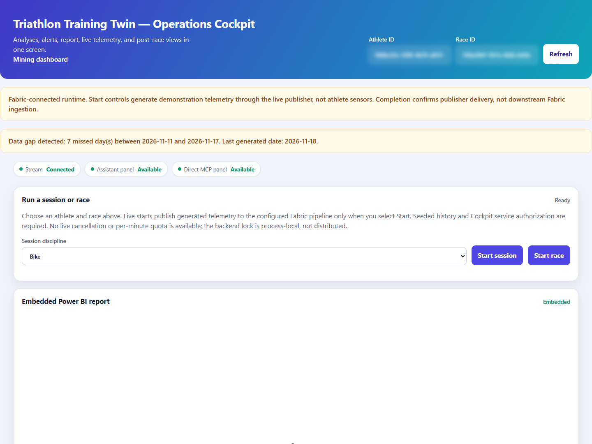

### Session: start, stream, finish

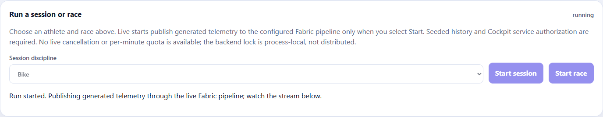

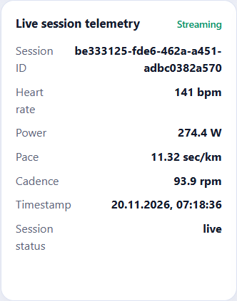

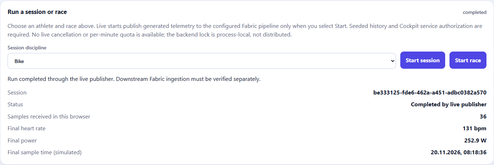

### Race: live splits and summary

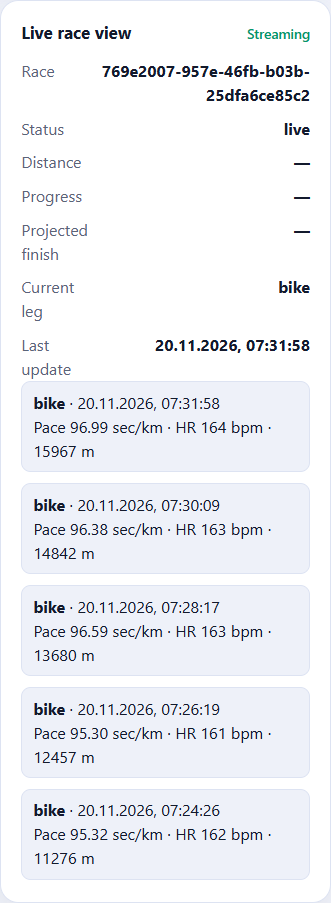

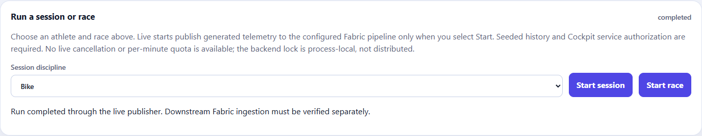

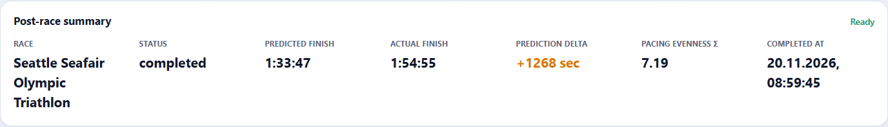

## Mining: plant and evidence

[Open Mining](https://ontologydemo.liberatetheinnerchild.net/mining/).
One visitor starts a shared, server-bounded ten-minute run. Other visitors join
that run; opening the page never starts another publisher.

### Waiting is a real state

The countdown has started, but receipts are not yet visible. Unknown KPIs are
not replaced with healthy zeros.

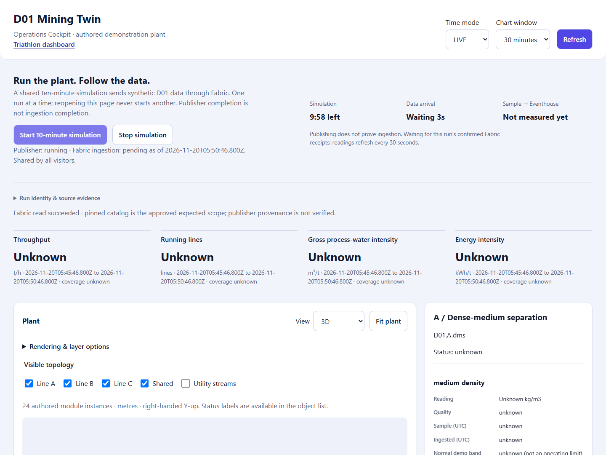

### Reading the pictures

Authored plant geometry is a navigation aid, not engineering geometry. Sensor
evidence status is not physical equipment health. Sample-to-Eventhouse delay
uses the separately observed receipt; unknown raw-ingestion proof stays null.
Browser polling adds time before a visitor sees the measurement.

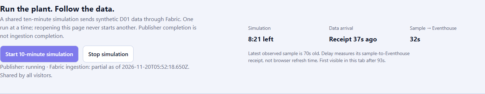

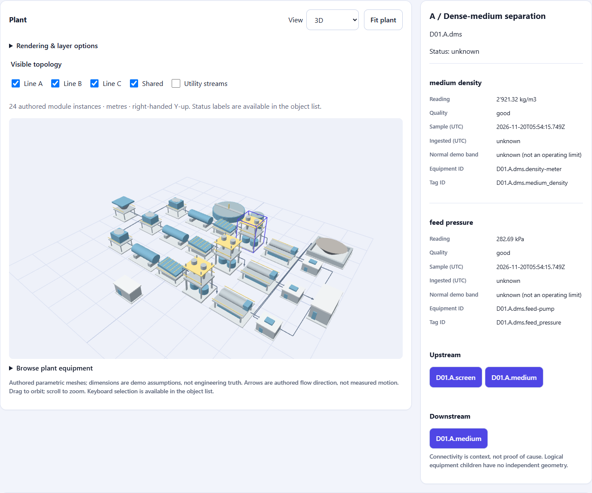

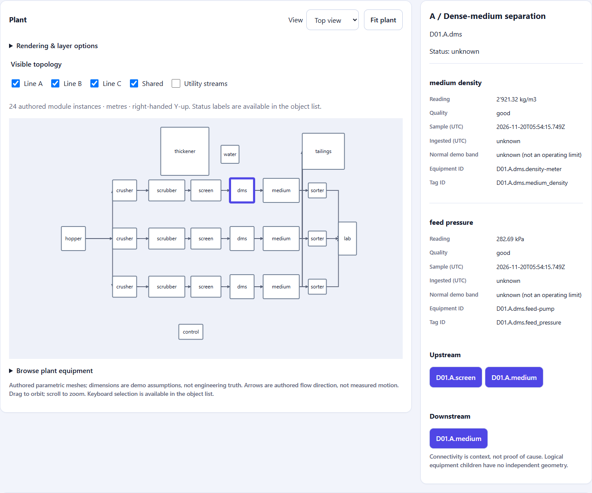

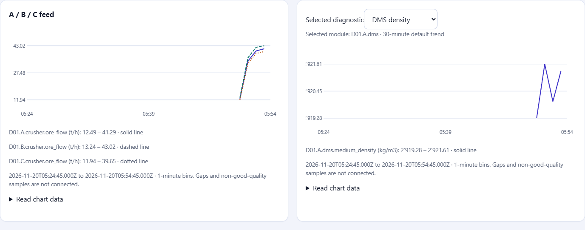

Early-run captures retain partial coverage, unknown KPIs and unavailable incident
evidence. These are not screenshots of a fully reconciled run.

### Completion is a separate observation

The captured ten-minute run subsequently reached `publisher_complete` and exact
ingestion reconciliation: **1,010 telemetry and 52 state event IDs**, each seen
once in both raw and validated tables, with zero conflicts or quarantined events.
This is dated run evidence, not a continuous-availability guarantee.

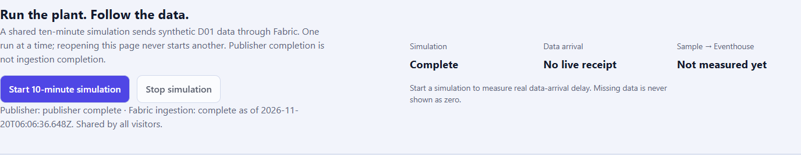

Mobile layout and full-page captures

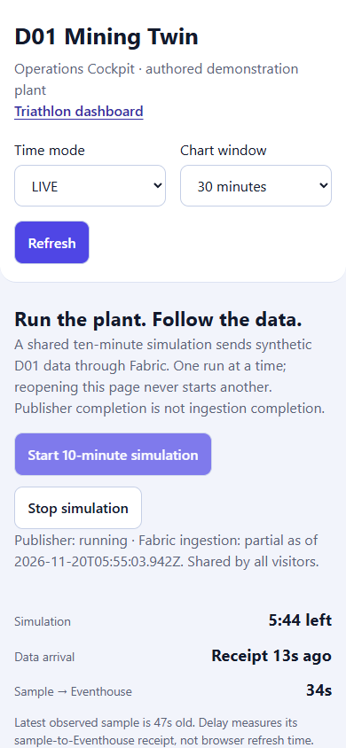

[Full desktop capture](screenshots/mining-full.png) ·
[Full mobile capture](screenshots/mining-mobile-full.png)

## Native Fabric: retained captures

These are real screenshots retained from this lab's **15 November** verification,
not new captures of the current deployment. They show private static model/report
surfaces, not a live ontology time-series binding.

### Ontology editor

The authored plant, line, module, equipment, tag and stream entity types and their
relationships. This is model context, not telemetry acceptance.

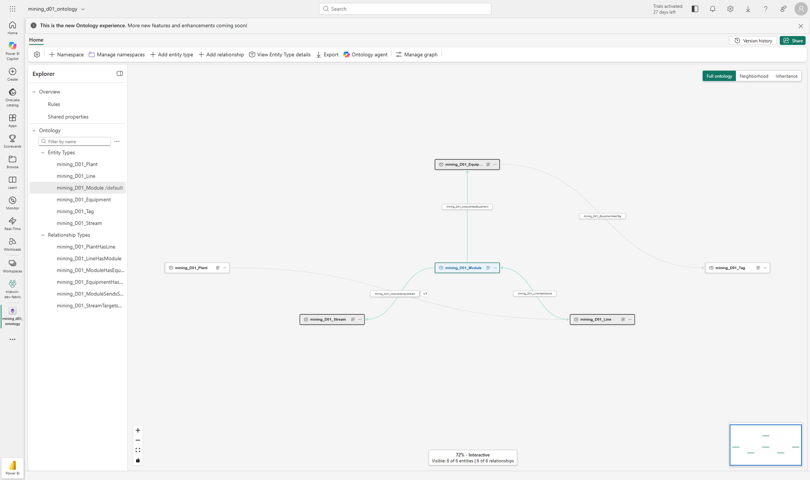

### Ontology graph

Six node types and relationship types in the native graph surface. The retained
parent-model warning is visible; a loaded graph is not proof of a current binding.

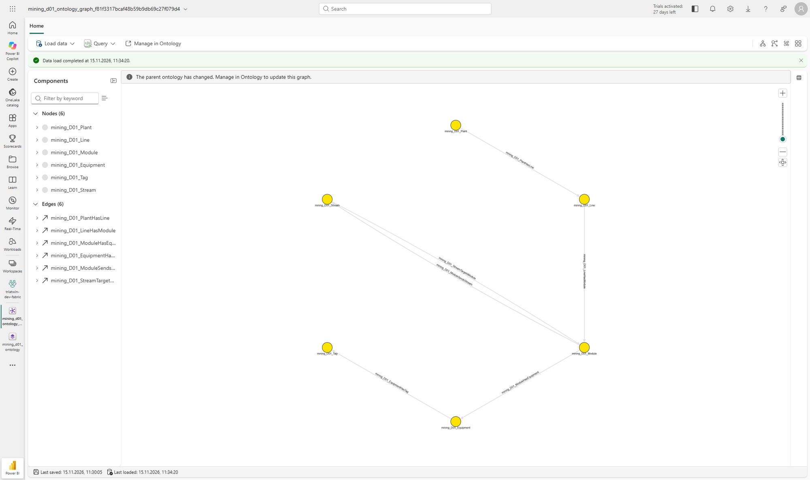

### Static topology report

Catalog-derived modules, equipment, tags and process-stream relationships in
Power BI inside Fabric. These counts are structural, not live production KPIs.

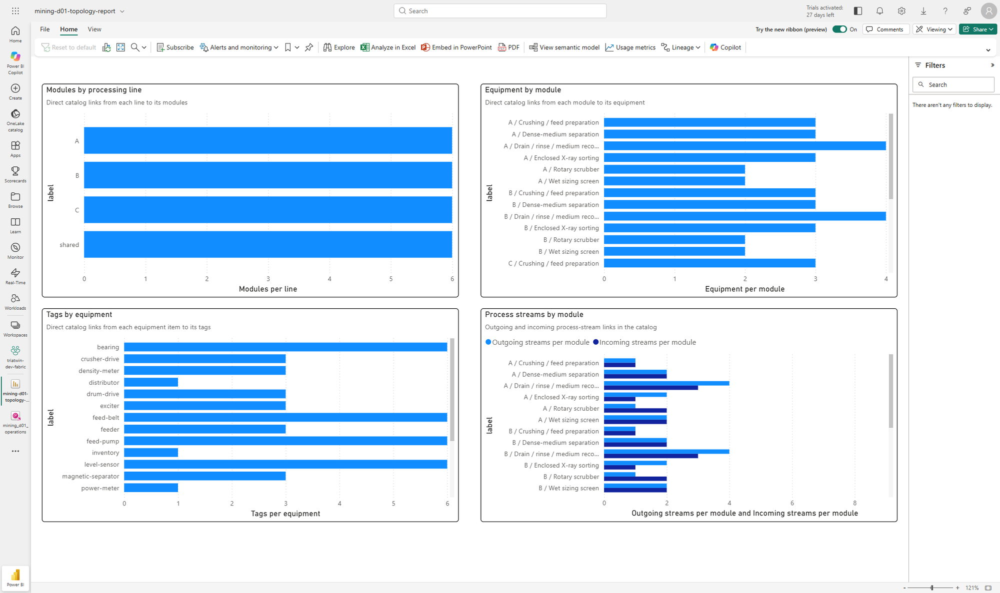

**Fresh native captures remain sign-in gated:** on 20 November the Fabric
browser reached an account picker, and an authorized account selection could
not be completed. No substitute UI or sign-in screen is presented as current
Fabric evidence.

For current data-plane verification, an authorized operator can inspect:

| Open in Fabric                         | Inspect                                                                               | Evidence to retain                                                            |
| -------------------------------------- | ------------------------------------------------------------------------------------- | ----------------------------------------------------------------------------- |
| Mining Eventstream                     | Custom endpoint, telemetry/state filters, derived streams and Eventhouse destinations | Exact routing plus a fresh event; `Running` alone is not receipt proof        |
| Mining Eventhouse / KQL queryset       | `mining_SourceReadiness()` and the exact run's raw/validated event IDs                | Source time, observed receipt, distinct/copy counts, conflicts and quarantine |
| Triathlon Eventhouse                   | Generated `sessionId` in `SessionMetric`, or `raceId` in `RaceSplit`                  | Actual matching rows and `ingestion_time()`, not only the browser stream      |
| Lakehouse / ontology / topology report | Authored plant and relationships                                                      | Static model context, explicitly not a live time-series binding               |

Use the [Developer UAT table](developer.md#uat-the-actual-environment) for
acceptance criteria and the [data architecture](architect.md#full-data-architecture)
to identify each layer. Native Fabric requires workspace authorization; public
Cockpit access does not grant it.

## Reproduce a useful capture

1. Note the UTC capture time, app revision and generated run/entity ID privately.
2. Capture initial waiting, a genuinely observed reading, then completion
   separately. Retain stale, partial or unavailable labels.
3. Before publishing, exclude account menus, credentials, connection strings,
   unrelated tenant artifacts and personal data. Never export browser sessions.
4. Pair screenshots with actual exact-run query evidence. A screenshot is not
   a substitute for event reconciliation or permission checks.
