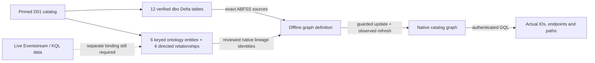

# D01 native ontology static source

## Current-experience TMDL definition

For new Mining-owned ontologies, use the current TMDL format, not the additive
old-experience executor below. Generate a definition from the same pinned
catalog and an observed Lakehouse SQL endpoint:

```powershell
$definition = .\scripts\mining-ontology\New-MiningTmdlDefinition.ps1 `
  -CatalogPath $catalog -SqlServer $observedSqlHostname `
  -SqlDatabase $observedLakehouseName -LogicalId $logicalId
```

This command is offline: it generates twelve DirectLake backing tables, six
keyed entity types and six directed entity relationships. Each relationship
uses its actual catalog junction table and two native table relationships;
Stream -> Module is kept distinct from Module -> Stream. No telemetry, graph
instances, refresh jobs or synthetic observations are generated.

Deploy only to a new Mining-owned ontology through Fabric's
`create item` / `updateDefinition` API. Verify the catalog first. Before an
update, read and preserve the complete live definition and its platform-owned
`.platform` part, check that no other writer changed the preimage, and replace
the generated `.platform` part with the live part. Journal the operation
before submission, reconcile its terminal status without resubmitting it,
then read the resulting definition. Fabric can normalize SQL expressions
to `ONT_ALM_*` relative references and assign omitted lineage tags; a
byte-for-byte definition comparison is therefore not an instance-access test.

The current ontology is a virtual semantic/context layer, not a general-purpose
query engine. Verify a consumer against the bound sources separately. In the
private Fabric portal, inspect the entity property bindings and source rows.
For relationship traversal, choose **Manage graph**, select eligible catalog
entities/relationships, materialize them, and run a real path query. Graph
materialization is optional and explicit; source updates require separate
refresh verification. A successful definition write proves neither those
instances nor an assistant answer. Browser sign-in is required for portal
checks and is separate from Azure CLI API access.

References: [current TMDL definition](https://learn.microsoft.com/rest/api/fabric/articles/item-management/definitions/ontology-definition),
[current ontology overview](https://learn.microsoft.com/fabric/iq/ontology/overview),
[optional graph materialization](https://learn.microsoft.com/fabric/iq/ontology/how-to-use-ontology-graph).

## Catalog-backed native graph

`New-MiningGraphDefinition.ps1` prepares the graph associated with a selected
Mining-owned ontology. It is **offline**, requires PowerShell 7.4+ (the
GitHub Actions runner already provides it), and performs no cloud writes or
refreshes. Save and review complete native ontology and graph snapshots first:
bare `{"parts":[...]}` definitions and wrapped `{"definition":{"parts":[...]}}`
responses are supported.

```powershell
$request = .\scripts\mining-ontology\New-MiningGraphDefinition.ps1 `
  -CatalogPath $catalog -OntologyId $observedOntologyId `
  -OntologyDefinitionPath $ontologySnapshot `
  -OntologyDefinitionSha256 $reviewedOntologyHash `
  -GraphPreimagePath $graphSnapshot -GraphPreimageSha256 $reviewedGraphHash `
  -OneLakeTablesPath $observedOneLakeTablesPath
```

The source root must be the exact HTTPS `oneLakeTablesPath` returned by the
**static source Lakehouse**, not the ontology-generated Eventhouse. Graph
Delta sources require its equivalent
`abfss://<workspace>@onelake.dfs.fabric.microsoft.com/<lakehouse>/Tables/dbo/<table>`
representation. HTTPS Delta paths fail native graph validation.

The generator reuses the pinned catalog and preserves current native entity,
relationship, and backing-table lineage identities. Six node types expose
`id` and `label`; six directed edge types explicitly map both endpoint
properties, node keys, and composite edge identities. `ModuleSendsStream` and
`StreamTargetsModule` retain opposite directions. It rejects reversed or
changed physical bindings, stale snapshot hashes, foreign graph metadata,
and existing graph configurations that differ from this contract. Only an
empty native shell or an equivalent generated configuration is accepted;
custom configurations require separate review, not forced replacement.
`.platform`, styling, settings, and other parts retain their original payloads.

For deployment, resolve and verify the exact Mining graph item and caller
separately. Re-read the graph immediately before submitting, reject preimage
drift, and journal the reviewed request hash **before** calling
`POST /v1/workspaces/<workspace>/items/<graph>/updateDefinition`. Omit the
optional `format` field. Reconcile the returned operation before retrying;
unknown delivery is not failure. Read back all parts afterward: native JSON
formatting can differ without structural drift, and Fabric can add default
scaling settings. Unexpected changes still require investigation; preserved
`.platform` bytes must match.

An accepted definition can start a refresh automatically. Inspect
`GET /v1/workspaces/<workspace>/items/<graph>/jobs/instances` before requesting
another refresh. Require the actual job to finish with `Completed` and no
failure reason, then run real graph queries. For the pinned catalog, expect
**199 nodes and 248 edges**, but counts alone are insufficient: compare each
type's actual IDs and directed endpoint pairs with the catalog tables.

The authenticated [GQL Query API](https://learn.microsoft.com/fabric/graph/gql-query-api)
uses `POST /v1/workspaces/<workspace>/graphModels/<graph>/executeQuery?beta=true`
with `{"query":"..."}`. HTTP 200 is not query success: inspect `status.code`,
additional statuses, and any continuation. Continue the same query with the
opaque, once-percent-encoded `nextPage` token; do not restart it. GQL reserves
`label`, so quote that property:

```gql
MATCH (n:mining_D01_Plant)
RETURN n.id AS id, n.`label` AS node_label
LIMIT 2
```

This is an explicit **static catalog graph**, not proof that the ontology's
normalized ALM source references resolve, that all ontology properties are
materialized, or that live telemetry is bound. A portal warning that the
parent ontology has changed must remain visible until that integration is
verified. Do not clear it by blindly regenerating sources. Graph, ontology,
and OneLake remain private; only the Cockpit is publicly accessible. The
beta query API is for this demonstration, not a production availability claim.



## Legacy additive source

This additive **old-experience JSON** source consumes the simulator-owned
`apps/simulator/src/mining/plant-catalog.json` at its pinned byte hash. It does
not copy the catalog or modify the athlete templates. Merge the canonical
catalog change before using that repository path.

Privately save the existing ontology `getDefinition` **definition object**
(`{"parts":[...]}`), its SHA-256, a fresh current definition, and an exact-target
JSON file containing `TenantId`, `SubscriptionId`, `WorkspaceId`, `OntologyId`,
`StaticLakehouseId`, `OntologyOutputLakehouseId`, and `SourceSchema` (`dbo`).
Use the **existing static binding source** Lakehouse, never the ontology's
generated output Lakehouse. The planner requires native static-binding evidence
for that target, distinct item IDs, and a reviewed target-file hash.

```powershell
.\scripts\mining-ontology\plan.ps1 -CatalogPath $catalog `
  -BaselinePath $baseline -BaselineSha256 $reviewedBaselineHash `
  -CurrentPath $current -TargetPath $privateTarget `
  -TargetSha256 $reviewedTargetHash -OutputDirectory $newPrivateBundle
```

The bundle contains twelve static CSV tables, exact row/byte-hash receipts,
schema-scoped load request bodies, and the complete additive native definition.
Receipts describe **generated local bytes**, not loaded Delta rows. Six
namespaced types model Plant -> Line (including shared) -> Module -> Equipment
-> Tag, plus Stream. Directed Module -> Stream -> Module links preserve all
50 material/utility routes. Original identifiers, units, authored dimensions,
positions, ports, routing and evidence remain in `metadata_json`; Plant source
provenance and the telemetry contract use separate `source_json` and
`telemetry_event_contract_json` columns to preserve their complete JSON within
the SQL analytics endpoint's 8,000-byte string limit. Oversized fields fail
before any network request. Logical
equipment gets no invented geometry or readings. Only the 56 catalog tags
exist. The source Lakehouse holds catalog data, never a telemetry copy.

Reserved native integer IDs are listed in
[`ownership.json`](../../infra/fabric/mining-ontology/ownership.json).
Bindings/contextualizations use deterministic GUIDs. Colliding IDs/names,
changed owned parts, unknown catalog bytes and current snapshot drift fail
closed. Every unrelated definition part retains its exact payload and metadata;
`definition.json` and `.platform` are not reconstructed. A repeated plan against
the desired snapshot has no added parts. `-Mode Verify` compares snapshots
**offline**; it does not prove active instances or source data.

## Reviewed static apply

### Catalog-only loading

The catalog can be loaded into a new, Mining-owned schema-enabled Lakehouse
without reading or changing an ontology. Import the module and supply an exact
target containing `TenantId`, `SubscriptionId`, `WorkspaceId`,
`StaticLakehouseId`, `SourceSchema` (`dbo`), `CallerObjectId`, `SqlEndpointId`,
`SqlServer` and `SqlDatabase`, resolved from the live Lakehouse:

```powershell
Import-Module .\scripts\mining-ontology\MiningOntology.psm1
Invoke-MiningCatalogLoad -CatalogPath $catalog -Target $target `
  -ReceiptPath $newPrivateReceipt -Mode Apply
Invoke-MiningCatalogLoad -CatalogPath $catalog -Target $target `
  -ReceiptPath $newPrivateReceipt -Mode Verify
```

Verify is read-only and requires all twelve tables to match exactly. Apply
requires authorized writes, uses the same source/SQL preflight and row
verification as static apply, and refuses an existing receipt. After an
interruption, reconcile each acknowledged operation and actual table content
first. A new receipt can continue loading absent tables only after every
existing table matches; it never overwrites or repairs a mismatched table.
Catalog loading is not ontology deployment or proof of active twin instances.

Canonical receipt CSV uses doubled quotes; upload CSV uses the Lakehouse
loader's backslash escaping for quotes and backslashes. Each representation
has its own hash. Native regional operation locations are validated, then
polled by operation ID only through `api.fabric.microsoft.com`, never by
sending credentials to the returned redirect host.

### Ontology apply

`plan.ps1` stays offline (its legacy Apply mode remains blocked).
`apply.ps1` provides the separate executor, defaulting to **read-only Verify**.
No hosted execution is implied by this source. Before regenerating/reviewing
the bundle, add `CallerObjectId`, `SqlEndpointId`, `SqlServer` (hostname only)
and `SqlDatabase` (the source Lakehouse display name) to the private target.
These must match live source metadata; they are not connection strings.

Use the **same pinned planner arguments** with the executor, supplying the
reviewed `plan.json` byte hash and a new private receipt path:

```powershell
.\scripts\mining-ontology\apply.ps1 -CatalogPath $catalog `
  -BaselinePath $baseline -BaselineSha256 $reviewedBaselineHash `
  -CurrentPath $current -TargetPath $privateTarget `
  -TargetSha256 $reviewedTargetHash -BundleDirectory $newPrivateBundle `
  -ReviewedPlanSha256 $reviewedPlanHash -ReceiptPath $newPrivateReceipt `
  -Mode Apply -ApproveStaticWrites -AcknowledgeNonAtomicUpdate `
  -ExclusiveWriterWindowId $approvedWindow
```

Only run this after explicit, target-specific write approval and an externally
coordinated exclusive-writer window. The flags acknowledge that approval; they
do not grant permissions or implement a remote lock. The executor regenerates
the authoritative plan and validates every reviewed bundle file, rather than
trusting editable request URLs or an arbitrary owned-part list. It uses the
already signed-in Azure CLI profile without signing in or switching accounts,
checks tenant/caller/audience/lifetime for each token, and uses encrypted
`System.Data.SqlClient` connections. HTTP and query clients are injectable for
offline tests; tokens stay in memory and never enter receipts.

Preflight checks the exact schema-enabled source/SQL endpoint and ontology,
a complete shortcut inventory, database metadata visibility and `dbo` SELECT.
Content-addressed CSVs use OneLake ADLS create/append/flush and byte readback.
Conditional creation never overwrites existing files. Only **absent** owned
tables are loaded, using `.../schemas/dbo/tables/<owned-table>/load?beta=true`;
existing tables must already match or apply refuses. A fresh absence check
precedes each load. No telemetry is copied, and no existing table is repaired
or overwritten. Load completion is bounded and returned operation locations
must remain on the supported exact Fabric routes; writes are never retried.

Each table must resolve to its exact local `Tables/dbo/<owned-table>` path,
without shortcut redirection, with the expected string columns. The bounded
Delta JSON history (versions 0 through latest, at most 128, no checkpoints)
must prove column mapping is absent/`none`. Null metadata properties alone
are **not** accepted as proof. Unsupported histories stop explicitly rather
than guessing current state. SQL verification rejects row-security filters,
reads up to expected-count-plus-one rows, ordinally sorts and hashes all
loaded values against the reviewed CSV. Blank CSV cells and SQL NULL are
equivalent empty strings. SQL endpoint lag stops apply without resubmitting
the load; Verify can be run later.

The private receipt is an append-only JSONL journal of full state snapshots
(read the last complete line), durably flushed **before every write**. Earlier
preimages survive a torn final record, which blocks repeat Apply. It retains the complete
native preimage, operation locations, created-table/file residuals, row hashes
and manual rollback guidance. Definition update rechecks the live preimage,
submits the fully preserved additive parts without metadata changes, and
verifies the entire postimage. There is **no atomic CAS or automatic rollback**.
An unresolved receipt blocks repeat Apply. Reconcile using `-Mode Verify`
with a new receipt path; never delete an uncertain receipt and retry blindly.
A completed receipt can be reused for a second Apply: actual rows/definition
are checked again and no writes occur.

Required deployment checks are not yet hosted-verified: the exact caller needs
source Lakehouse write/load access (delegated `Lakehouse.ReadWrite.All`), OneLake
file read/write and shortcut-inventory read access, ontology read/write
(`Item.ReadWrite.All` or applicable item scope), and SQL connectivity on TCP
1433 with complete metadata visibility and source-schema SELECT. Coordinate
least privilege with the estate owner; this tooling never grants roles.
Schema-scoped beta load availability must be established on the actual item.
An API/SQL failure is recorded as such, not automatically called a permission
issue. Approval, token acquisition or feature failures must be resolved before
an authorized run; missing curated telemetry does not block this static path.

The old API supports `TimeSeries` / `KustoTable` with Eventhouse **item** ID,
cluster URI, database, table, timestamp column and property/key mappings.
No validated curated mining table is available yet: `event:dynamic` raw
ingestion is not a columnar, validated reading source. No time-series binding
is emitted until the ingestion owner establishes that prerequisite. Ontology
definition update has no documented atomic CAS: an approved exclusive-writer
window and fresh live preimage check are still required, not implied by hashes.
Retirement on **January 31, 2027** is a caveat, not authorization to migrate,
replace the shared ontology or enable tenant features.

References: [old native definition](https://learn.microsoft.com/rest/api/fabric/articles/item-management/definitions/ontology-old-definition),
[old binding requirements](https://learn.microsoft.com/fabric/iq/ontology/old-experience/how-to-bind-data),
[schema-aware CSV loading](https://learn.microsoft.com/fabric/data-engineering/lakehouse-api),
[load permissions/payload](https://learn.microsoft.com/rest/api/fabric/lakehouse/tables/load-table),
[OneLake metadata](https://learn.microsoft.com/fabric/onelake/table-apis/delta-table-apis-overview),
[OneLake ADLS access/parity](https://learn.microsoft.com/fabric/onelake/onelake-access-api),
[append/flush](https://learn.microsoft.com/rest/api/storageservices/datalakestoragegen2/path/update),
[SQL verification connectivity](https://learn.microsoft.com/fabric/data-warehouse/connectivity),
[native updateDefinition](https://learn.microsoft.com/rest/api/fabric/core/items/update-item-definition).
